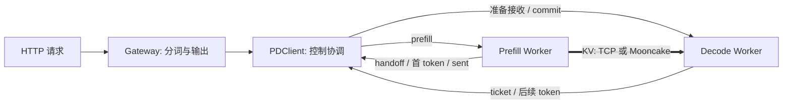

# MoonCake_SGlang

基于 [Mini-SGLang](https://github.com/sgl-project/mini-sglang) 的大模型推理项目，
保留 Unified 推理引擎，扩展 **Prefill/Decode（P/D）分离**，并接入 Mooncake Transfer Engine。
当前重点是多请求组批推理、逐层 KV 传输与后续 Prefill 计算重叠，以及独立取消和资源回收。
Python 包名和命令入口仍为 `minisgl`。

> **当前版本（2026-11-23）**：独立 P/D Worker、并发控制面、Prefill/Decode
> 组批和 Mooncake 逐层异步传输已实现，有历史 CPU/TCP 记录及受控 CPU 测试。真实 GPU/RDMA 正确性、
> 双服务器运行、实际重叠比例与性能收益尚未验收。下文部署命令是配置模板。

## 功能与边界

| 能力 | 当前实现 |
|---|---|
| Unified 推理 | 保留上游连续组批、Radix 前缀缓存、Chunked Prefill、CUDA Graph、调度重叠和 TP。 |
| 独立 P/D Worker | P 处理 prompt 并生成首 token；D 导入 prompt KV 后生成后续 token。 |
| 多请求推理 | 异步控制连接、Prefill batch、安装完成后动态加入 Continuous Batching Decode；按请求取消和回收。 |
| TCP 参考传输 | 完整 Prefill 后交接 CPU 字节，具有长度、SHA-256、票据与完成确认检查。 |
| Mooncake GPU 传输 | Worker 内持有 TE，启动期预注册显存池，按层组异步打包、发送，不经 CPU KV 暂存或 helper。 |
| HTTP 网关 | 独立进程分词，提供 `/v1/chat/completions` 非流式/SSE、`/v1/models` 和断连取消。 |
| 资源管理 | D 私有 KV 页、异常回滚、槽位排空后复用、GPU reader 保护、完成未知隔离及 Worker 退役。 |

当前 split 模式限制为 **TP=1、greedy、真实 safetensors 权重、未量化 MHA KV、eager 执行**。
每个 Worker 支持多个请求，由单个 GPU 调度主循环组 batch；关闭 CUDA Graph 和原有 CPU/GPU 调度重叠。
Mooncake 的逐层计算/通信重叠是独立机制；尚未实现多 P/D 自动发现或负载均衡。

模型源码包含 Llama、Qwen2、Qwen3、Qwen3MoE 和 Mistral；这些模型尚未全部通过新的
P/D/RDMA 验收。上游性能结果也不代表本项目逐层传输版本的性能。

## 架构与数据路径



`PDClient` 固定配置一组 P/D 地址，仅转发请求、票据、handoff 和确认消息；
**完整 KV payload 由 P 直接交给 D，不经过客户端。** 两个 Worker 各自加载相同模型，
各自管理 KV 池和物理页，P 的页编号不会直接成为 D 的写入位置。

```text
TCP（默认，完整 Prefill 后发送）：
P GPU KV 池 → CPU bytes → TCP → CPU 接收区 → D GPU KV 池

Mooncake（按层组发送，与后续层计算重叠）：
P GPU KV 池 → transfer_stream gather → 预注册环形槽位
  → Mooncake / GPUDirect RDMA → D 预注册 GPU 接收池
  → GPU scatter → D 自己分配的 KV 页 → Decode
```

### 逐层 KV 传输如何工作

1. 启动时，P 创建独立 transfer stream、后台发送线程和固定环形槽位；D 创建连续接收池。
   显存只在启动时注册，正常请求不反复注册或注销。
2. Prefill 前，客户端向 D 预留私有 KV 页与接收池租约，再把接收票据交给 P。
3. P 写好一个层组的 KV 后，只记录 CUDA event、入队，继续发射后续层计算。
   后台等待该 event，打包到空闲槽位，等待打包完成后提交异步 RDMA Write。
4. 一个槽位的原生操作进入终态、且 `ticket.drained` 为真后，才允许复用。
   槽位满时由后台线程等待，逐层计算回调不等待传输。
5. P 分别返回 batch 内各请求的首 token，按请求收敛传输、返回 `sent`。
   D 收到 `commit` 后在独立 stream 安装 KV；主循环通过 `event.query()` 确认完成，
   归还该接收切片，并将请求加入活跃 Decode batch。

D 的连续接收池支持多个互不重叠的租约；P 的 `BatchTransferPlan` 绑定批内各请求的 slots 和目标票据。
同目标复用控制连接，不同目标独立提交；一个请求取消或首 token 为 EOS 不会取消同批其他请求。
并发、页预算与启动参数详见[多请求调度说明](docs/pd/batching.md)。

### 多请求组批与退出

Worker 控制线程持续接收请求；GPU 主循环通过 `PrefillManager` 和 `DecodeManager` 组批执行前向。
批次成员在每轮前向完成后调整，实际 batch 大小取决于到达时间、token 预算、请求表行及 KV 页容量。

- **P 完成 Prefill**：返回首 token，退出后续 Prefill 调度。后台 gather 不再读取源 KV 后，
  归还 P 的请求表行和私有 KV 占用；Staging 槽位仍须等 RDMA 排空，客户端请求继续在 D 生成。
- **D 完成安装**：以 `event.query()` 确认后归还接收切片，动态加入活跃 Decode batch。
- **D 结束生成**：遇到 EOS（未忽略 EOS）、达到预算或取消后，单独移出并回收资源。
  其余请求继续，已经就绪且容量允许的新请求可加入后续 batch。

例如 Decode batch 为 `[A, B, C]`，B 结束且 D 已安装就绪时，后续 batch 可以是 `[A, C, D]`。
回收表示容量可复用；显存池常驻，Radix 前缀缓存可能保留可驱逐 KV，显存占用不必立即下降。
`n=1` 指一个 HTTP 请求生成一个候选，不限制多请求并发或 GPU batch 大小。

当前使用 Chunked Prefill 时，**在最后一个 token chunk 中逐层发送完整 prompt KV**，
其中包含较早 chunk 和命中前缀的 KV；尚未实现每个 token chunk 的增量发送。
D 提前收到早期层 KV，也仍需等待 P 产生首 token，并确认所有层安装完成才能续算。

首 token 已触发 EOS 或满足生成预算时，不启动 D 续算。Mooncake 会取消未提交任务，
排空已提交写入后归还 D 的预留资源。取消或超时不能证明 DMA 已停止；完成未知的地址、
Tensor 和 ticket 必须保留，无法安全回收时后端要求 Worker 退役。
详见 [逐层传输说明](docs/pd/layered_transfer.md)。

## 环境与安装

### GPU 推理环境

- Linux x86_64/aarch64；项目声明 Python ≥3.10，本地开发使用 Python 3.12。
- NVIDIA GPU、兼容的驱动/CUDA Toolkit 和 C++ 编译工具链；部分算子首次运行会 JIT 编译。
- PyTorch `<2.10.0`、Transformers `>=4.56.0,<=4.57.3`、FlashInfer、sgl-kernel 等，
  完整依赖见 [pyproject.toml](pyproject.toml)。

```bash
git clone https://github.com/luckywty/MoonCake_SGlang.git
cd MoonCake_SGlang

uv venv --python 3.12 .venv-gpu
source .venv-gpu/bin/activate
uv pip install -e '.[dev]'

python -c 'import torch; print(torch.__version__, torch.version.cuda, torch.cuda.is_available())'
```

下文从项目根目录执行，并使用满足运行依赖的 Python 环境。
`/models/Qwen3-0.6B`、IP 和 HCA 名称都是示例，需替换；dtype 应与实际 GPU 能力一致。
两端的权重、tokenizer/EOS、dtype、页大小、层分组和 KV 布局需要匹配。
两进程共用一块 GPU 时会各自加载模型并分配池，需额外评估显存，不能替代双 GPU/双机验收。

### Mooncake 额外条件

```bash
uv pip install -e '.[dev,pd-mooncake]'
```

当前 extra 声明 `mooncake-transfer-engine==0.3.12.post1`、`cuda-bindings>=12.9,<14`。
**包版本号不保证安装的原生扩展包含所需接口**，还需要：

- CUDA 构建的 `mooncake.engine`，提供 `SUPPORT_CUDA`、`submit_scatter_write`、ticket `drain`
  和 `COMPLETED / FAILED_DRAINED / COMPLETION_UNKNOWN` 三态。
- 支持 GPU 内存注册的 RDMA NIC、驱动和 GPU/NIC 拓扑，以及可用的 peer-memory 或 DMA-BUF 路径。
- 两端 TE 自身的 RPC/RDMA 通路可达；仅开放 Worker 控制端口不足以完成原生传输。

运行时使用安装的扩展，不要求把 Mooncake 源码复制进本仓库。
项目不会在缺少 CUDA/RDMA 条件时静默退回 CPU、TCP 或 helper。
普通 CUDA、WSL2 或容器可运行，也不等于 GPUDirect RDMA 可用。
扩展与部署边界见 [Mooncake 直传说明](docs/pd/mooncake_direct.md)。

## 启动 Unified 服务

```bash
CUDA_VISIBLE_DEVICES=0 PYTHONPATH=python python -m minisgl \
  --model /models/Qwen3-0.6B --worker-role unified \
  --host 127.0.0.1 --port 1919 --dtype bfloat16
```

Unified 是默认角色，可省略 `--worker-role unified`；多 GPU 使用 `--tensor-parallel-size N`，
交互终端使用 `--shell-mode`。这些选项不能直接套用于 split Worker。

## 启动 TCP P/D 参考路径

以下为同一台服务器、两块 GPU 的配置。分别在两个终端启动并激活 GPU 环境：

```bash
# GPU 0：P，1919 为自定义控制端口
CUDA_VISIBLE_DEVICES=0 PYTHONPATH=python python -m minisgl \
  --model /models/Qwen3-0.6B --worker-role prefill \
  --host 127.0.0.1 --port 1919 --dtype bfloat16 \
  --attention-backend fi --page-size 1 --pd-transfer-backend tcp \
  --max-running-requests 32 --max-prefill-length 8192
```

```bash
# GPU 1：D，1929 为控制端口，1931 为 KV 数据端口
CUDA_VISIBLE_DEVICES=1 PYTHONPATH=python python -m minisgl \
  --model /models/Qwen3-0.6B --worker-role decode \
  --host 127.0.0.1 --port 1929 --pd-data-port 1931 --dtype bfloat16 \
  --attention-backend fi --page-size 1 --pd-transfer-backend tcp \
  --max-running-requests 32
```

Worker 就绪后运行 Token ID 客户端：

```bash
PYTHONPATH=python python -m minisgl.disagg.client \
  --prefill 127.0.0.1:1919 --decode 127.0.0.1:1929 \
  --input-ids '[1,2,3,4,5]' --max-tokens 8 --ignore-eos
```

示例 ID 仅展示调用格式，正式验证应使用目标 tokenizer 产生的输入。
客户端输出 Token ID；文本请求使用下文 HTTP 网关。
TCP 跨服务器部署时需使用可达 IP，D 通配绑定时设置 `--pd-advertise-host`。

## 启动双服务器 Mooncake P/D

假设 P 的地址为 `10.0.0.11`、D 为 `10.0.0.12`，各使用 GPU 0 和 HCA `mlx5_0`。
两端安装兼容扩展并加载相同模型，分别启动：

```bash
# P 服务器
CUDA_VISIBLE_DEVICES=0 PYTHONPATH=python python -m minisgl \
  --model /models/Qwen3-0.6B --worker-role prefill \
  --host 0.0.0.0 --port 1919 --dtype bfloat16 \
  --attention-backend fi --page-size 1 \
  --pd-transfer-backend mooncake --pd-mooncake-host 10.0.0.11 \
  --pd-mooncake-device mlx5_0 --pd-layers-per-chunk 2 --pd-staging-slots 3
```

```bash
# D 服务器
CUDA_VISIBLE_DEVICES=0 PYTHONPATH=python python -m minisgl \
  --model /models/Qwen3-0.6B --worker-role decode \
  --host 0.0.0.0 --port 1929 --pd-data-port 1931 \
  --pd-advertise-host 10.0.0.12 --dtype bfloat16 \
  --attention-backend fi --page-size 1 \
  --pd-transfer-backend mooncake --pd-mooncake-host 10.0.0.12 \
  --pd-mooncake-device mlx5_0 --pd-layers-per-chunk 2 --pd-staging-slots 3
```

```bash
# 任意能访问两端 Worker 的客户端机器
PYTHONPATH=python python -m minisgl.disagg.client \
  --prefill 10.0.0.11:1919 --decode 10.0.0.12:1929 \
  --input-ids '[1,2,3,4,5]' --max-tokens 8 --ignore-eos
```

Mooncake 模式的 `1931` 用于后端控制握手，KV 字节走 RDMA。
`--pd-mooncake-host` 填本机可被对端访问的 TE 地址，`--pd-mooncake-device` 填 HCA 名称；
GPU 仍由 `CUDA_VISIBLE_DEVICES` 选择。客户端自动协商传输能力，两端使用配套的新 Worker 与客户端。

## HTTP 网关

P/D Worker 控制端口不提供 HTTP。网关独立加载 tokenizer，不创建模型 Engine；
在能访问两端 Worker 的机器上启动：

```bash
PYTHONPATH=python python -m minisgl.disagg.gateway \
  --prefill 10.0.0.11:1919 --decode 10.0.0.12:1929 \
  --model /models/Qwen3-0.6B --host 0.0.0.0 --port 1940 \
  --max-inflight-requests 32 --max-inflight-tokens 65536
```

同机 TCP 配置将 P/D 地址改为 `127.0.0.1:1919` 和 `127.0.0.1:1929`。
在网关所在机器发送请求：

```bash
curl http://127.0.0.1:1940/v1/chat/completions \
  -H 'Content-Type: application/json' \
  -d '{"model":"/models/Qwen3-0.6B","messages":[{"role":"user","content":"你好"}],"temperature":0,"max_tokens":16,"stream":false}'
```

将 `stream` 改为 `true` 使用 SSE。网关目前支持 greedy 子集，示例显式设置 `temperature=0`；
要求 `n=1`，不支持自定义 stop 或 presence/frequency penalty。
自定义 Worker 协议尚无认证/TLS，应按受控网络部署。

## 参数、显存与运行观察

| 参数 | 默认值 / 含义 |
|---|---|
| `--worker-role` | 默认 `unified`；split 选择 `prefill` 或 `decode`。 |
| `--max-running-requests` | 默认 256；Worker 的请求表行容量，实际并发还受页、准入和传输预算限制。 |
| `--max-prefill-length` | 默认 8192；每个 Prefill batch 的 token 预算，可分块处理长 prompt。 |
| `--pd-transfer-backend` | 默认 `tcp`；`mooncake` 启用逐层 GPU 路径。 |
| `--pd-layers-per-chunk` | 默认 1；每组传几层，尾组可不足，P/D 保持一致。 |
| `--pd-staging-slots` | 默认 3；P 环形槽位数量，范围 2～4。 |
| `--pd-data-port` | D 默认控制端口 +2；TCP 传 KV，Mooncake 传控制消息。 |
| `--pd-advertise-host` | D 对外公布的后端地址；通配绑定时必须指定。 |
| `--pd-mooncake-host` | 本机可达 TE 地址，不能填对端或通配地址。 |
| `--pd-mooncake-device` | 可选的逗号分隔 HCA 名称。 |
| `--pd-timeout` | 默认 120 秒；超时不能证明原生 DMA 已停止。 |
| `--pd-max-transfer-bytes` | 默认 1 GiB；限制完整 prompt KV 大小，并用于计算启动池容量。 |
| `--pd-max-registered-bytes` | 默认单次上限的两倍；每个 Worker 的注册显存预算。 |
| `--pd-max-pending-transfers` | 默认 32；限制注册数及 Mooncake 在途请求、接收租约和目标连接数。 |
| `--pd-max-queued-requests` | 默认 128；尚未回收的已准入请求上限。 |
| `--pd-max-queued-tokens` | 默认 KV token 容量的 4 倍；准入请求的 prompt+max_tokens 预算。 |
| `--pd-batch-wait-ms` | 默认 2；新 Prefill 请求的组批等待窗口。 |
| `--pd-output-queue-size` | 默认 128；每个连接的输出队列容量。 |
| `--pd-max-quarantine-seconds` | 默认 300 秒；隔离超龄需要处置或退役，不会自动释放未知地址。 |

Engine 先为总注册预算预留显存，再确定 KV 页数；显式 `--num-pages` 同样检查预算。
大层组配合多个槽位可能需要减少槽位或提高预算；模型、最终 KV 池、传输池及算子工作区
仍需一起评估。D 池按请求切片复用，切片总量受注册预算限制。容量公式见[多请求调度说明](docs/pd/batching.md)。

Worker 使用 `--max-running-requests` 控制活跃行数，`--max-prefill-length` 控制每个 Prefill batch 的 token 预算。
网关可设置 `--max-inflight-requests 32 --max-inflight-tokens 65536`；Worker 还会检查实际 KV 页和未来输出预算。
非流式 HTTP 的容量拒绝返回 429；`n=1` 限制单请求候选数量，不限制并发请求数或 GPU batch 大小。

就绪日志中的 `overlap=false` 表示原有调度重叠关闭；`kv_transfer_overlap=true` 表示启用逐层传输。
健康信息位于 `transfer.mooncake`，可观察 `registered_bytes`、`registered_buffers`、
`pending_operations`、`quarantined_buffers`、`oldest_quarantine_seconds`、`layered.receive_leases` 和 `layered.receive_available_bytes`。
调度快照还有 `active_requests`、`max_prefill_batch`、`max_decode_batch`，健康检查不再等待整个请求结束。
注册池会一直驻留，空闲时应与启动基线一致，而非要求注册字节归零。

Worker 健康检查使用自定义 `Channel` 消息 `{"op":"health"}`，不能直接 `curl` 控制端口。
后端完成未知、隔离超期或不可恢复错误可能触发非零退出，需要外部进程监管重启。

## 测试与验收

### 标准库协议检查

不需要模型权重或 CUDA：

```bash
PYTHONPATH=python python3 -S -m unittest discover -s tests/disagg -v
PYTHONPATH=python python3 -S -m minisgl.disagg
```

第二条是协议/Mock 冒烟，不是真实模型入口。TCP 用例需要能够绑定本机 socket。

### CPU 参考与集成测试

在已安装 CPU 测试依赖或完整开发依赖的环境中：

```bash
PYTHONPATH=python python -m pytest -o addopts= -q tests/disagg tests/integration

# 阶段集合还包括缓存分配与消息序列化
FLUXINFER_TEST_PYTHON=python bash tools/pd/test_phase2.sh
```

本机已有 CPU `.venv` 时，可改用 `.venv/bin/python`；环境与测试报告不随 Git 分发。
`-o addopts=` 关闭默认覆盖率输出，环境重建和无 socket 子集命令见[项目交接文档](交接文档/项目交接文档.md)。

| 测试 | 覆盖范围 |
|---|---|
| `tests/disagg/` | 整体/逐层票据、生命周期、角色、Mock/TCP、帧限制与撤销。 |
| `test_pd_entrypoints.py` | CLI、角色分派及加载模型前的配置检查。 |
| `test_pd_tensor_cache.py` | dtype、稀疏 slots、dummy 页、页分配回滚与 Radix 借用保护。 |
| `test_pd_pipeline.py` | 两进程 CPU attention 模型经实际 TCP 续算并对照 token。 |
| `test_pd_failures.py`、`test_pd_gateway.py` | 失败清理、HTTP/SSE、结束原因与断连；网关主要使用桩客户端。 |
| `test_pd_layered.py` | 受控 DMA/event 下的实际发送队列/runtime、背压、槽位与租约、终态、取消和新握手续算。 |
| `test_pd_batching.py` | 多请求实际组批、参考输出一致、不同 D 独立完成、分块/EOS 取消、页预算与安装 event。 |
| `test_pd_control_loop.py` | 内存通道驱动完整并发 Worker 服务和 PDClient；4 请求并发及关闭单个 generator。 |
| `test_pd_layered_cuda.py` | 真实 CUDA 分组打包/安装检查，不包含原生 RDMA。 |
| `test_pd_gpu.py` | 显式 opt-in 的真实 GPU 模型对照，默认 TCP，可选择 Mooncake。 |

`TinyEngine` 是确定性 CPU attention 参考模型，复用实际 Scheduler、KV 池和页表，
不下载 Hugging Face 权重。逐层所有权测试使用内存控制通道，端到端用例另使用真实 socket；
CUDA event 和原生 DMA 的 CPU 适配器不能证明真实 GPU/RDMA 并发。

本轮无 socket 回归为 **131 passed、10 skipped、5 deselected、113 subtests passed**。
测试使用确定性 CPU attention 验证多请求组批、独立参考 token 对照，以及内存通道中的完整并发 Worker/PDClient 控制循环。
10 项 GPU 用例跳过，5 项逐层 socket 用例排除；独立 TCP 与 HTTP 回归未纳入此子集。
真实 socket 受沙箱限制，沙箱外执行申请未获批准；尚未执行真实 GPU/RDMA 验收。
复现命令见[多请求调度说明](docs/pd/batching.md)，交接要点见[项目交接文档](交接文档/项目交接文档.md)。

### GPU 模型对照

工具在同机独立进程中对照 Unified 与 P/D 的 greedy token，默认使用 TCP：

```bash
PYTHONPATH=python python tools/pd/verify_phase2_gpu.py \
  --model /models/Qwen3-0.6B --prefill-device 0 --decode-device 1 \
  --page-size 1 --cache-type radix --output-dir /tmp/minisgl-pd-gpu
```

具备 GPU/RDMA 与兼容扩展时，选择逐层 Mooncake：

```bash
PYTHONPATH=python python tools/pd/verify_phase2_gpu.py \
  --model /models/Qwen3-0.6B --prefill-device 0 --decode-device 1 \
  --transfer-backend mooncake --layers-per-chunk 2 --staging-slots 3 \
  --mooncake-host 10.0.0.11 --mooncake-device mlx5_0 \
  --output-dir /tmp/minisgl-layered-gpu
```

工具还对比开始/结束健康信息，检查注册池稳定、无遗留操作、隔离或接收租约。
pytest 模型入口需要 `FLUXINFER_PD_GPU_MODEL` 和 CUDA；可用
`FLUXINFER_PD_TRANSFER_BACKEND=mooncake`、`FLUXINFER_PD_LAYERS_PER_CHUNK`、
`FLUXINFER_PD_MOONCAKE_HOST`、`FLUXINFER_PD_MOONCAKE_DEVICE` 选择对应配置。
该工具不能代替双服务器测试，实际重叠与加速收益还需 GPU/network 时间线测量。

## 代码与文档

```text
python/minisgl/
├── server/             # 参数、Unified HTTP、角色分派
├── scheduler/          # Prefill/Decode 调度、页分配、请求表
├── engine/             # 模型执行、显存预算、采样、CUDA Graph
├── kvcache/            # MHA KV 池、Radix/Naive 缓存、层就绪与打包
├── disagg/
│   ├── protocol.py     # 整体交接数据契约
│   ├── layered_protocol.py   # 前置接收票据与层组布局
│   ├── worker.py       # P/D 调度器适配与入口
│   ├── service.py      # 并发控制面、GPU 组批循环、异步安装与独立回收
│   ├── layered_sender.py     # BatchTransferPlan、公平发送、目标连接复用
│   ├── allocator.py    # 多租约接收池空闲区间管理
│   ├── admission.py    # 客户端并发请求/token 预算
│   ├── client.py       # 控制协调与 Token ID 流
│   ├── gateway.py      # HTTP、分词、SSE
│   ├── tcp_backend.py  # CPU 字节参考传输
│   ├── layered_mooncake.py   # 预注册池、后台层组发送、租约
│   ├── mooncake_runtime.py   # TE、注册区、原生操作与隔离
│   └── cuda_transfer.py      # CUDA 地址、同步与 RDMA 可见性
├── models/             # 模型结构与权重加载
├── attention/          # Attention 后端
└── kernel/             # C++/CUDA/JIT 算子
tests/                  # 协议、集成、缓存、CUDA 与算子检查
tools/pd/               # 阶段测试、GPU 对照与冒烟
docs/pd/                # P/D 专项设计和阶段记录
交接文档/                # 架构、验证边界、待办和运行指南
```

- [逐层 KV 传输](docs/pd/layered_transfer.md)：缓冲池、层组流水线、所有权、取消与验收入口。
- [多请求调度](docs/pd/batching.md)：异步控制面、批量传输、动态 Decode、显存与准入参数。
- [Mooncake GPU 直传](docs/pd/mooncake_direct.md)：TE、CUDA/RDMA 条件、部署与资源边界。
- [项目交接文档](交接文档/项目交接文档.md)：按交接快照记录架构、提交历史、测试和待办。
- [Phase 2 报告](docs/pd/phase2.md) / [移植说明](docs/pd/phase2_porting.md)：TCP/CPU 参考阶段历史。
- [Unified 架构](docs/structures.md) / [上游功能说明](docs/features.md)：原有引擎设计，参数以当前 `--help` 为准。

## 性能与后续工作

上游性能脚本保留在 [benchmark/offline/](benchmark/offline/) 和 [benchmark/online/](benchmark/online/)。
运行前需调整其固定模型、端口、输入输出长度、采样与并发负载，不能直接作为当前 P/D 的性能结论。

下一步优先完成原生扩展、GPU 字节、双机 token、取消/晚到写入及长期资源回收验收；
再建立 TTFT、TPOT、吞吐与显存基线，测量 `layers_per_chunk=1/2/4` 和槽位数的影响，
随后完善多请求调度的硬件验收和多 P/D 管理。目前没有可发布的本地 GPU/RDMA 性能达标结果。

## 上游与许可证

本项目基于 [sgl-project/mini-sglang](https://github.com/sgl-project/mini-sglang)，
保留其推理引擎并增加 P/D 与 Mooncake 适配。感谢 Mini-SGLang、SGLang 与 Mooncake 的开源实现。
项目采用 [MIT 许可证](LICENSE)；模型权重、Mooncake 和其他依赖遵循各自许可证。
