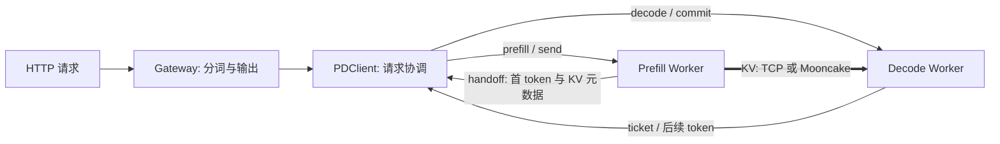

# MoonCake_SGlang

基于 [Mini-SGLang](https://github.com/sgl-project/mini-sglang) 的大模型推理项目，扩展 **Prefill/Decode（P/D）分离**，并接入 Mooncake Transfer Engine，探索两台服务器之间的 GPU KV Cache 交接。

项目保留原有 Unified 推理入口，提供 TCP 参考传输、独立 P/D Worker、请求协调客户端和 HTTP 网关。Mooncake 路径由 Worker 本进程持有 Transfer Engine，通过 GPU 缓冲区进行 RDMA 传输。

> **当前状态（2026-11-22）**：CPU/TCP 参考路径已有历史测试记录；新的 Mooncake GPU/RDMA 实现已完成代码改造和静态检查，尚未完成真实 GPU、RDMA 与双服务器验收。本文启动命令是使用模板，不代表对应硬件配置已通过测试。

## 功能与边界

| 能力 | 当前实现与验证范围 |
|---|---|
| Unified 推理 | 保留上游的连续组批、Radix 前缀缓存、Chunked Prefill、CUDA Graph、调度重叠和 TP；本地未重新验收全部 GPU 能力。 |
| 独立 P/D Worker | P 完成 Prefill 并生成首 token，D 导入 KV 后续算；当前为 TP=1、greedy、串行请求、eager 执行，关闭 Graph/overlap。 |
| TCP KV 交接 | Worker 间直接传输 CPU 字节，具备长度、SHA-256、票据、撤销和完成确认等检查；CPU 参考路径有历史验证。 |
| Mooncake GPU 直传 | Worker 内持有 TE，无 helper、无 CPU KV 暂存；保留两端 GPU 打包/安装拷贝，尚未硬件验收。 |
| HTTP 网关 | 独立进程处理分词、非流式/SSE 输出和断连取消；当前为 OpenAI 风格接口的 greedy 子集。 |
| 资源管理 | 分页 KV、接收端私有页、分配回滚、Radix 借用保护；新 GPU 路径增加注册预算、完成检测和未知状态隔离。 |

模型源码包含 Llama、Qwen2、Qwen3、Qwen3MoE、Mistral。模型实现存在不等于所有模型均通过新的 P/D/RDMA 验收；当前也没有多 P/D 发现、负载均衡或计算/传输重叠的验收结论。

## 架构与数据流



`PDClient` 中转 handoff、接收票据和确认消息，**完整 KV payload 不经过客户端**。P 生成的首 token 先返回用户；若已达到生成预算或触发 EOS，则无需 D 续算。客户端固定配置一组 P/D 地址。

两种数据路径：

```text
TCP：
P KV pool → CPU bytes → TCP → CPU 接收区 → D KV pool

Mooncake：
P GPU KV pool → 独立连续 GPU Tensor
  → P Worker 持有的 TE → GPUDirect RDMA → D Worker 持有的 TE
  → D GPU 接收 Tensor → GPU scatter → D KV pool
```

Mooncake 模式下，TCP 仍用于控制握手、地址描述和终态确认。取消请求只撤销交付资格，不能证明 DMA 已停止；完成未知的 Tensor、注册区和 ticket 会继续保留并后台 drain，无法安全回收时要求 Worker 退役重启。细节见 [GPU 直传说明](docs/pd/mooncake_direct.md)。

## 环境与安装

### GPU 推理环境

- Linux x86_64/aarch64；项目声明 Python ≥3.10，建议使用 Python 3.12。
- NVIDIA GPU、兼容的驱动/CUDA Toolkit 和 C++ 编译工具链；部分算子首次运行需要 JIT 编译。
- PyTorch `<2.10.0`、Transformers `>=4.56.0,<=4.57.3`、FlashInfer、sgl-kernel 等，完整依赖见 [pyproject.toml](pyproject.toml)。

```bash
git clone https://github.com/luckywty/MoonCake_SGlang.git
cd MoonCake_SGlang

# 单独创建 GPU 环境，便于保留已有 CPU 测试环境
uv venv --python 3.12 .venv-gpu
source .venv-gpu/bin/activate
uv pip install -e '.[dev]'

python -c 'import torch; print(torch.__version__, torch.version.cuda, torch.cuda.is_available())'
```

下文命令均从项目根目录执行。模型示例使用 `/models/Qwen3-0.6B`，需替换为实际模型目录；也可使用 `Qwen/Qwen3-0.6B` 等模型 ID 下载权重。BF16 示例应按目标 GPU 能力调整，两端 P/D 的权重、dtype、页大小和 KV 布局必须匹配。

### Mooncake 额外依赖

在 GPU 环境中安装可选依赖：

```bash
uv pip install -e '.[dev,pd-mooncake]'
```

当前声明 `mooncake-transfer-engine==0.3.12.post1`、`cuda-bindings>=12.9,<14`。**包版本号不能保证原生扩展具备所需能力**，还必须确认：

- 安装的 `mooncake.engine` 是兼容的 CUDA 构建，提供 `SUPPORT_CUDA`、`submit_scatter_write`、ticket `drain` 和明确的三态完成接口。
- RDMA NIC、驱动、GPU/NIC 拓扑及 peer-memory 或 DMA-BUF 注册路径满足 GPU 内存传输条件。
- 两端 TE 的 RPC/RDMA 通路可达；仅开放外层 Worker 端口不足以完成原生传输。

适配时参考的本地 Mooncake 源码版本是 `301261358eef0b13fa55645ccde4a988f1ca7505`。如 wheel 缺少接口，需要另外构建兼容扩展。运行时使用安装的 `mooncake.engine`，不是复制 Mooncake 源码到本仓库；已有兼容扩展时不要求保留其源码目录。

Mooncake 后端会拒绝不满足 CUDA/RDMA 条件或冲突的传输配置，不会静默切换到 CPU/TCP/helper。普通 CUDA、WSL2 或容器可用也不构成 GPUDirect RDMA 可用的证明。

## 启动 Unified 服务

```bash
CUDA_VISIBLE_DEVICES=0 PYTHONPATH=python python -m minisgl \
  --model /models/Qwen3-0.6B --worker-role unified \
  --host 127.0.0.1 --port 1919 --dtype bfloat16
```

Unified 的 `--worker-role` 可省略。多 GPU TP 使用 `--tensor-parallel-size N`，交互模式使用 `--shell-mode`；这两项能力不能直接套用于 split Worker。

## 启动 TCP P/D 参考路径

以下是同一台服务器、两块 GPU 的示例，P/D 分别在两个终端运行，并激活各自的 GPU Python 环境。

```bash
# P Worker：控制端口 1919
CUDA_VISIBLE_DEVICES=0 PYTHONPATH=python python -m minisgl \
  --model /models/Qwen3-0.6B --worker-role prefill \
  --host 127.0.0.1 --port 1919 --dtype bfloat16 \
  --pd-transfer-backend tcp --page-size 1
```

```bash
# D Worker：控制端口 1929，KV 数据端口 1931
CUDA_VISIBLE_DEVICES=1 PYTHONPATH=python python -m minisgl \
  --model /models/Qwen3-0.6B --worker-role decode \
  --host 127.0.0.1 --port 1929 --pd-data-port 1931 \
  --dtype bfloat16 --pd-transfer-backend tcp --page-size 1
```

Worker 就绪后，运行 Token ID 客户端：

```bash
PYTHONPATH=python python -m minisgl.disagg.client \
  --prefill 127.0.0.1:1919 --decode 127.0.0.1:1929 \
  --input-ids '[1,2,3,4,5]' --max-tokens 8 --ignore-eos
```

示例 ID 仅用于展示接口，正式对照应使用目标模型 tokenizer 产生的固定输入。客户端返回生成的 Token ID；需要文本接口时使用下文网关。

只有一块 GPU 时可让两个 Worker 使用同一设备，但会各自加载模型、分配 KV 池，需要额外显存；同卡实验不能替代双机传输验收。TCP 跨服务器部署时，也需使用可达 IP，并在 D 通配绑定时设置 `--pd-advertise-host`。

## 启动双服务器 Mooncake P/D

示例假设 P 为 `10.0.0.11`，D 为 `10.0.0.12`，两端各使用 GPU 0 和 RDMA HCA `mlx5_0`。模型路径、IP、HCA 和 dtype 应按实际环境调整，两端均需安装兼容的 Mooncake 扩展。

```bash
# P 服务器
CUDA_VISIBLE_DEVICES=0 PYTHONPATH=python python -m minisgl \
  --model /models/Qwen3-0.6B --worker-role prefill \
  --host 0.0.0.0 --port 1919 --dtype bfloat16 --page-size 1 \
  --pd-transfer-backend mooncake --pd-mooncake-host 10.0.0.11 \
  --pd-mooncake-device mlx5_0
```

```bash
# D 服务器
CUDA_VISIBLE_DEVICES=0 PYTHONPATH=python python -m minisgl \
  --model /models/Qwen3-0.6B --worker-role decode \
  --host 0.0.0.0 --port 1929 --pd-data-port 1931 \
  --pd-advertise-host 10.0.0.12 --dtype bfloat16 --page-size 1 \
  --pd-transfer-backend mooncake --pd-mooncake-host 10.0.0.12 \
  --pd-mooncake-device mlx5_0
```

此模式下 `1931` 是 D 端后端控制握手端口，KV 字节走 Mooncake/RDMA。`--pd-mooncake-host` 填本机可被对端访问的地址，`--pd-mooncake-device` 填 HCA 名称，GPU 编号仍通过 `CUDA_VISIBLE_DEVICES` 选择。

## HTTP 网关

P/D Worker 的控制端口不是 HTTP 服务。网关可以部署在独立机器上，加载 tokenizer 并调用 `PDClient`，不创建模型 Engine：

```bash
PYTHONPATH=python python -m minisgl.disagg.gateway \
  --prefill 10.0.0.11:1919 --decode 10.0.0.12:1929 \
  --model /models/Qwen3-0.6B --host 0.0.0.0 --port 1940
```

同机 TCP 示例将两个端点改为 `127.0.0.1:1919` 和 `127.0.0.1:1929`。从网关所在机器发送请求：

```bash
curl http://127.0.0.1:1940/v1/chat/completions \
  -H 'Content-Type: application/json' \
  -d '{"model":"/models/Qwen3-0.6B","messages":[{"role":"user","content":"你好"}],"temperature":0,"max_tokens":16,"stream":false}'
```

将 `stream` 改为 `true` 使用 SSE。当前网关要求 greedy，例如 `temperature=0`，并限制 `n=1`，不支持自定义 stop 或 presence/frequency penalty。直接访问 Unified 时使用其服务端口 `1919`。自定义 Worker 协议当前没有认证/TLS，应在受控网络中部署。

## 关键参数与资源管理

| 参数 | 含义 / 默认值 |
|---|---|
| `--worker-role` | `unified` / `prefill` / `decode`，默认 `unified`。 |
| `--pd-transfer-backend` | `tcp` / `mooncake`，默认 `tcp`，仅 split 模式使用 Mooncake。 |
| `--pd-timeout` | 默认 120 秒；应用超时不能证明原生 DMA 已停止。 |
| `--pd-data-port` | D 端后端端口，默认 Worker 控制端口 +2；TCP 传 KV，Mooncake 传控制握手。 |
| `--pd-advertise-host` | D 向 P 公布的后端地址；D 通配绑定时必须显式填写。 |
| `--pd-mooncake-host` | 本机可达的 TE 地址，不是对端地址，也不能是通配地址。 |
| `--pd-mooncake-device` | 可选逗号分隔 HCA 名称，不是 CUDA 设备序号。 |
| `--pd-max-transfer-bytes` | Mooncake 单次 payload 上限，默认 1 GiB。 |
| `--pd-max-registered-bytes` | 每个 Mooncake Worker 活动及隔离注册区预算，默认单次上限的两倍。 |
| `--pd-max-pending-transfers` | 活动及遗留注册区数量上限，默认 32，不代表模型并发数。 |
| `--pd-max-quarantine-seconds` | 隔离处置时间，默认 300 秒；超期不会自动释放未证明安全的地址。 |
| `--page-size`、`--cache-type` | KV 分页与前缀缓存；P/D 应保持兼容配置。 |

Engine 会为 Mooncake 注册缓冲区预留显存，再计算 KV 页数；显式 `--num-pages` 也受预算限制。模型、KV 池、两端传输副本和算子工作区仍需一起评估。

健康检查使用自定义 `Channel` 消息 `{"op":"health"}`，不能直接 `curl` Worker 控制端口。后端报告注册字节、隔离数量与最老隔离年龄等；完成未知导致预算耗尽、隔离超期或引擎不可用时，Worker 可能非零退出，需要外部进程监管重启。

## 测试与验收

### 标准库协议和传输测试

无需模型权重和 CUDA，覆盖协议、状态机、Mock、TCP 和控制帧：

```bash
PYTHONPATH=python python3 -S -m unittest discover -s tests/disagg -v
PYTHONPATH=python python3 -S -m minisgl.disagg
```

第二条是协议/Mock 冒烟，不是真实模型推理入口。

### CPU 参考与集成测试

在已安装测试依赖的 GPU 开发环境或 CPU 测试环境中运行：

```bash
PYTHONPATH=python python -m pytest -o addopts= -q tests/disagg tests/integration

# 固定阶段集合：另外覆盖缓存分配和消息序列化
FLUXINFER_TEST_PYTHON=python bash tools/pd/test_phase2.sh
```

本地已有 CPU `.venv` 时，也可指定 `FLUXINFER_TEST_PYTHON="$PWD/.venv/bin/python"`。虚拟环境与其中的依赖快照不随 Git 分发，环境重建信息见 [项目交接文档](交接文档/项目交接文档.md)。`-o addopts=` 关闭默认覆盖率报告设置。

| 测试 | 主要覆盖范围 |
|---|---|
| `tests/disagg/` | handoff/票据、生命周期、角色、Mock/TCP、撤销、重复、半包与帧限制。 |
| `tests/integration/test_pd_entrypoints.py` | CLI、角色分派、构造前约束。 |
| `tests/integration/test_pd_tensor_cache.py` | KV dtype、稀疏 slots、dummy 页、分配回滚、Radix 借用页保护。 |
| `tests/integration/test_pd_pipeline.py` | 两进程 CPU attention 参考模型，经真实 TCP 续算并对照 token。 |
| `tests/integration/test_pd_failures.py` | 前向、元数据、接收准备、安装与清理故障。 |
| `tests/integration/test_pd_gateway.py` | HTTP、SSE、EOS、错误和断连；主要使用桩客户端/分词器。 |
| `tests/integration/test_pd_gpu.py` | 显式 opt-in 的 GPU 模型 + TCP P/D 对照。 |

CPU 参考模型由 [pd_reference.py](tests/integration/pd_reference.py) 的 `TinyEngine` 提供，复用真实 Scheduler、KV 池和页表，不下载 Hugging Face 模型。

2026-11-21 的历史 CPU/TCP 阶段汇总为 **105 passed、1 skipped、101 subtests passed**，GPU 用例因环境条件跳过。这些记录早于新的 GPU/RDMA 改造，不能视为当前 Mooncake 路径的验收结果。

### GPU 模型对照（TCP 后端）

```bash
PYTHONPATH=python python tools/pd/verify_phase2_gpu.py \
  --model /models/Qwen3-0.6B --prefill-device 0 --decode-device 1 \
  --page-size 1 --cache-type radix --output-dir /tmp/fluxinfer-phase2-gpu
```

或启用 pytest 用例：

```bash
FLUXINFER_PD_GPU_MODEL=/models/Qwen3-0.6B \
FLUXINFER_PD_PREFILL_DEVICE=0 FLUXINFER_PD_DECODE_DEVICE=1 \
PYTHONPATH=python python -m pytest -o addopts= -q tests/integration/test_pd_gpu.py
```

现有脚本在独立进程比较 Unified/P/D greedy token，**固定使用默认 TCP 后端，没有 Mooncake 选择参数**。当前尚无 Mooncake 专项验收脚本；需补齐 GPU 字节对照、实际 RDMA 路径、双机 token、取消/晚到写入、显存预算与退出回收验收。

## Benchmark 与后续工作

Unified 性能脚本位于 [benchmark/offline/](benchmark/offline/) 和 [benchmark/online/](benchmark/online/)。例如：

```bash
PYTHONPATH=python python benchmark/offline/bench.py
PYTHONPATH=python python benchmark/online/bench_simple.py
```

运行前阅读脚本中固定的模型、端口、并发与输入输出配置。它们主要面向上游 Unified 模式，不应直接作为串行 greedy P/D 网关的吞吐结论；本仓库尚未提供经过验收的 Mooncake 性能数据。

下一步优先完成原生扩展兼容性、GPU/RDMA 正确性和异常生命周期验收，再建立 TTFT/TPOT、吞吐与显存基线，推进注册缓冲区复用、计算/传输重叠和多 P/D 调度。

## 代码结构与文档

```text
python/minisgl/
├── server/        # 参数、Unified HTTP 与角色分派
├── scheduler/     # Prefill/Decode 调度、页分配、请求表
├── engine/        # 模型执行、显存预算、采样、CUDA Graph
├── kvcache/       # MHA KV 池、Radix/Naive 缓存
├── disagg/        # P/D 协议、Worker、客户端、网关、TCP/Mooncake
├── models/        # 模型结构与权重加载
├── attention/     # Attention 后端
├── kernel/        # C++/CUDA/JIT 算子
└── tokenizer/     # 分词与反分词
tests/             # 协议、集成、缓存与算子测试
tools/pd/          # 阶段测试、GPU/TCP 对照与冒烟工具
docs/pd/           # P/D 阶段报告和 GPU 直传说明
交接文档/           # 架构、进度、历史与待办
```

- [项目交接文档](交接文档/项目交接文档.md)：核心文件、提交历史、验证边界、待办和运行指南，按编写时快照记录状态。
- [Mooncake GPU 直传](docs/pd/mooncake_direct.md)：数据路径、CUDA/RDMA 条件、资源生命周期与部署参数。
- [Phase 2 报告](docs/pd/phase2.md) / [移植与启动指南](docs/pd/phase2_porting.md)：TCP/CPU 参考阶段的实现与历史验证。
- [上游功能说明](docs/features.md) / [Unified 架构](docs/structures.md)：阅读原有引擎能力；其中旧 CLI 简写和阶段表述以当前代码为准。

## 上游与许可证

本项目基于 [sgl-project/mini-sglang](https://github.com/sgl-project/mini-sglang)，保留其引擎结构并增加 P/D 与 Mooncake 适配。包名及命令入口仍为 `minisgl`。感谢上游项目及 Mooncake 开源实现。

许可证为 [MIT](LICENSE)，保留原有版权声明。Mooncake、模型权重和其他依赖遵循各自许可证。
