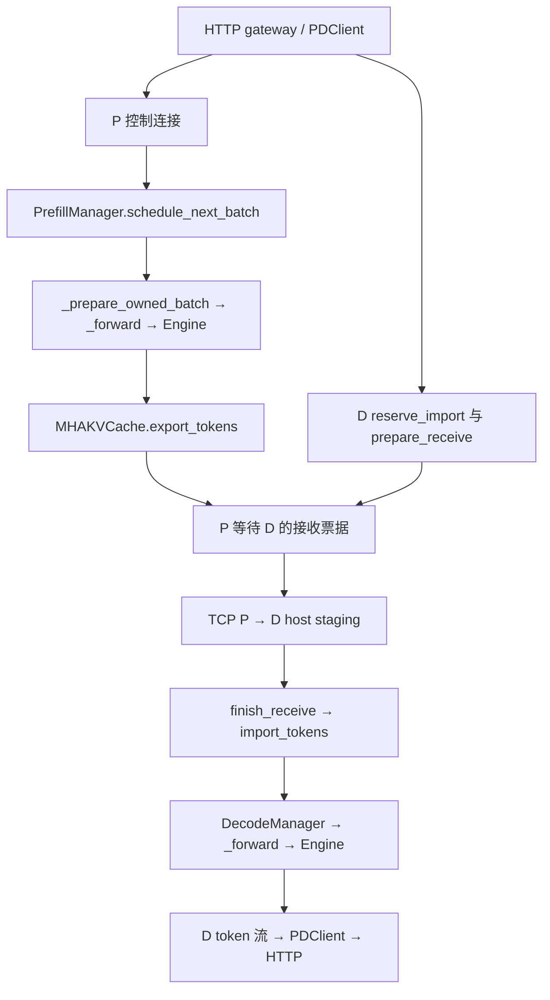

# FluxInfer · Phase 2 最小 P/D 分离

## A. 本阶段目标和实现结果

基线为 Phase 1 提交 `267ea95e795b200d86880a31f1d869c875534658`，开发分支为 `fluxinfer/pd-phase2-tcp`。本阶段实现了可运行的 P/D worker、路由客户端和 HTTP 网关，并沿用实际 mini-SGLang 的 Scheduler、PrefillManager、DecodeManager、Engine、CacheManager、TableManager 与 MHAKVCache。

| 需求 | 代码状态 | 验证状态 |
|---|---|---|
| P 仅执行 prompt Prefill，支持多块 | 已实现，完成最后一块后导出 handoff，执行期间不会调度 Decode batch | CPU 参考引擎驱动真实调度/缓存代码通过，CUDA Engine 待验证 |
| 有效 prompt KV 导出 | 已实现 export_tokens，紧凑排列 [K/V,layer,token,local_head,head_dim] | FP32/FP16/BF16 CPU Tensor 测试通过 |
| P → D 跨进程传输 | 已实现 TCP backend、接收票据、长度与 SHA-256 校验、完成确认 | 两个独立进程的真实 TCP 测试通过 |
| D 分配自己的页并安装 KV | 已实现 reserve_import、import_tokens 和本地 raw slot 映射 | 非连续源/目标页、尾页、dummy 排除通过 |
| 首 token 与 Decode 续算 | P 采样 y0，协调器只输出一次；D 输入 prompt+y0，后续输出从 index=1 开始 | CPU attention 模型的端到端 greedy 结果与全前缀重算一致 |
| 取消、断连、超时与清理 | 已实现控制连接终止、接收撤销、batch 边界检查、失败页回滚 | 取消/断连/安装失败/未完成 forward/借用前缀页保护通过 |
| 对外生成接口 | PDClient.stream/generate、命令行客户端、OpenAI 风格 HTTP 网关 | HTTP 非流式、SSE、EOS、错误、断连清理通过 |
| 真实 GPU 与原始 Unified 对照 | 已交付自动启动、采样记录、逐 token 对照及清理脚本 | 本次环境无 CUDA GPU，测试跳过，GPU 验收尚未完成 |

本阶段代码和 CPU 验收已完成。完整验收仍需真实 GPU 的 Unified/P/D token 对照，本次不能据此宣称双 GPU 或多节点功能已经验证。

实现采用同一模型、同一未量化布局、TP=1、greedy。每个 worker 同时处理一个请求，P/D 两个 worker 可执行不同请求的各自阶段。split worker 固定使用 eager 与同步批次消费，初始化时关闭 CUDA Graph，使用现有 Prefill/Decode manager 构造 batch。Unified 的正常 batch 准备仍经过同一成功路径，GPU 回归由随包脚本补验。

本次不增加 Mooncake、Store、HiCache、SSD、FP8 交接和 EAGLE 状态交接。原有 Phase 0/1 文档描述其固定阶段提交，Phase 2 从这里开始允许 prefill/decode CLI 实际启动。

## B. 修改文件清单

路径均相对于 mini-SGLang 仓库根目录。

| 文件路径 | 新增/修改 | 类或函数 | 原因 |
|---|---|---|---|
| python/minisgl/disagg/role.py | 修改 | require_serving_role | 给专用 PDWorkerScheduler 开放 split 构造，普通 Scheduler 保留入口检查 |
| python/minisgl/disagg/control.py | 新增 | Channel、StartRequest、read_bytes/write_bytes | 有界控制帧、IO 超时、取消检查和请求结构 |
| python/minisgl/disagg/tcp_backend.py | 新增 | TcpTransferBackend | 实际 TCP KV 数据面及接收确认，复用 Phase 1 的 host reservation 逻辑 |
| python/minisgl/disagg/worker.py | 新增 | PDWorkerScheduler、serve_worker、launch_split_worker、checkpoint_fingerprint | P/D 控制、实际推理调用、资源所有权与模型身份校验 |
| python/minisgl/disagg/client.py | 新增 | PDClient、response、main | 会合、票据转发、消费确认与单一 token 输出出口 |
| python/minisgl/disagg/gateway.py | 新增 | create_app、main | HTTP 请求/流式输出接到 PDClient，复用原请求模型与 DetokenizeManager |
| python/minisgl/kvcache/mha_pool.py | 修改 | _transfer_indices、export_tokens、import_tokens | 有效 token 打包/散写，校验 dtype、字节数、slot 与池边界 |
| python/minisgl/scheduler/cache.py | 修改 | allocate_paged、reserve_import、discard_private | 导入私有页预留、失败回滚、释放已分配但尚未生成 KV 的页 |
| python/minisgl/scheduler/scheduler.py | 修改 | __init__、_prepare_batch、_prepare_batch_metadata | 专用角色入口和已配页 batch 的元数据准备复用 |
| python/minisgl/server/args.py | 修改 | ServerArgs、parse_args | worker 数据端口、超时、公布地址和启动参数校验 |
| python/minisgl/server/launch.py | 修改 | launch_server | split 角色进入实际 TCP worker，默认角色进入原 HTTP 启动路径 |
| tests/disagg/test_tcp.py | 新增 | TestTcp、TestControl | 真实跨进程 TCP、撤销、重复、半包、校验失败及帧限制 |
| tests/integration/test_pd_entrypoints.py | 修改 | CLI/分派测试 | 更新阶段行为，验证合法 split 分派及构造前约束 |
| tests/integration/pd_reference.py | 新增 | TinyEngine、cpu_scheduler、run_cpu_worker、reference_tokens | CPU 测试参考引擎，驱动真实调度/池/页表代码 |
| tests/integration/test_pd_tensor_cache.py | 新增 | pool/allocator 测试 | dtype、稀疏页、dummy 页、分配回滚及 Radix 借用页保护 |
| tests/integration/test_pd_pipeline.py | 新增 | P/D 续算测试 | 两进程 CPU attention 模型的真实网络交接、输出对照和取消 |
| tests/integration/test_pd_failures.py | 新增 | 故障注入测试 | forward/metadata/注册/安装失败、布局失配与不可恢复清理 |
| tests/integration/test_pd_gateway.py | 新增 | HTTP 测试 | 非流式、SSE、EOS 结束原因、HTTP 错误与断连关闭 |
| tests/integration/test_pd_gpu.py | 新增 | test_actual_gpu_greedy_pd_continuation | 显式 opt-in 的真实 GPU 验收，CPU 环境跳过 |
| tools/pd/test_phase2.sh | 新增 | 验收脚本 | 固定本阶段 CPU/可选 GPU 测试集合 |
| tools/pd/verify_phase2_gpu.py | 新增 | baseline、run、main | 在独立进程比较 Unified/P/D greedy token，支持单/双 GPU |
| docs/pd/phase2.md | 新增 | 本报告 | A–G 实现与验证说明 |
| docs/pd/phase2_porting.md | 新增 | 移植与启动指南 | 文件合并、运行、测试与回滚命令 |

运行时使用原有依赖和 Python 标准库，无 pyproject.toml 变动。checkpoint 内容哈希会在 worker 初始化时读取权重文件，额外启动 IO 尚未测量。

## C. 具体代码修改

完整相关代码位于交付包 `files/`，新增和修改文件均保留仓库目录。`phase2.patch` 提供完整 unified diff，没有省略实现。

以下原始行号以 Phase 1 基线为准。修改后定位可参照随包 `SOURCE_LOCATIONS.json`。

| 已有文件与原始位置 | 实际变更和调用关系 |
|---|---|
| disagg/role.py L10 | require_serving_role 新增 split_worker 关键字。普通 Scheduler(config) 遇到 split 角色仍要求专用入口，PDWorkerScheduler 显式使用该入口 |
| scheduler/scheduler.py L47 | __init__ 接受内部 _split_worker 参数，传给角色检查。Engine 构造的正常次序保持原成功路径 |
| scheduler/scheduler.py L206 | 将 allocate_paged 后的元数据准备提取为 _prepare_batch_metadata，原 _prepare_batch 仍先 pad、分配、再准备。split worker 在分配完成后记录所有权边界，再复用该方法 |
| scheduler/cache.py L42 | 保存 _allocate 返回的 page-start Tensor。页展开或写表失败时归还这些页，避免中途失败丢失 allocator 所有权 |
| scheduler/cache.py L55 前 | 新增 reserve_import，分配自己的物理页、展开 raw slots 并写本地 table。新增 discard_private，根据实际 allocated_len 归还私有页并解 prefix handle 锁 |
| kvcache/mha_pool.py L45–59 后 | 新增打包/安装方法。原 store_kv、k_cache/v_cache 接口继续由原 attention backend 调用 |
| server/args.py L15、L55 | 新增 pd_timeout、pd_data_port、pd_advertise_host 及 CLI。decode 的数据端口必须区别于本机 RPC 和 Gloo 端口，wildcard decode bind 需要可供 P 连接的公布地址 |
| server/launch.py L40 | parse_args 后按角色分派。split 启动一个专用 GPU worker，HTTP 网关另用独立进程运行 |

新增 imports 在完整源码和补丁中逐项可见。worker.py 复用 Batch、Req、SamplingParams、PendingReq、ChunkedReq、Scheduler 与 MHAKVCache，未替换 Engine.forward_batch、attention 内核和模型实现。

### 实际调用链

HTTP gateway 不创建 Engine，P/D worker 在各自进程内加载模型。RPC 控制帧只携带请求、handoff、ticket、确认和 token，KV 字节由 P 直接发往 D 的数据端点。

## D. 可移植产物和提交

交付包括独立阶段提交、Git Patch、全部相关源码、修改清单、源代码函数行定位、测试与环境记录，以及归档校验和。完整阶段 SHA 在 `COMMITS.json` 和 patch 的 From 行，分支为 `fluxinfer/pd-phase2-tcp`。

基线 SHA 必须对应已移植的 Phase 1。补丁只包含本阶段差异，你分支上的 FP8/EAGLE/调度自定义代码需人工合并。远端 PR 未创建。

## E. 本地移植顺序

先新增 control/tcp_backend、运行纯标准库 TCP 测试，再新增池导出/安装和 allocator 导入/丢弃接口。随后合并 Scheduler 元数据准备和角色入口，新增 PDWorkerScheduler、PDClient，最后接 CLI 分派和 HTTP 网关。移植指南包含所有 Linux 命令、独立 worktree、`git apply --check`、验证和回滚。

参考 `docs/pd/phase2_porting.md`。三个程序分别是 `python -m minisgl --worker-role prefill`、`python -m minisgl --worker-role decode` 和 `python -m minisgl.disagg.gateway`。

## F. 测试和验收

| 类别 | 实际执行范围 |
|---|---|
| 纯标准库 | 41 项。包含 Phase 1 契约和真实 TCP 的跨进程、半包、撤销及重复测试 |
| CPU 原生配置/CLI | 22 项。包括真正 parse_args、启动分派和不支持配置的提前拒绝 |
| CPU KV pool/allocator | 10 项。真实 MHAKVCache Tensor 的 FP32/FP16/BF16 导出/恢复、非连续页及 prefix 保护 |
| CPU 两进程续算 | 14 项。真实 PDWorkerScheduler 逻辑和真实网络，推理由测试 TinyEngine 执行 |
| CPU 故障注入 | 7 项。包含尚未生成的已配页、安装后失败、模型身份和不可恢复清理 |
| HTTP | 5 项。请求解析、SSE、EOS、远端失败和断连时关闭生成器 |
| 上游回归 | 6 项。缓存分配与消息序列化 |
| 真实 CUDA | 1 项 opt-in 验收。本次跳过，需要 CUDA 及 FLUXINFER_PD_GPU_MODEL |

最终结果以随包 TEST_REPORT 与 evidence/tests.log 为准。本次环境是 Python 3.12.14、Torch 2.9.1+cpu，未发现 CUDA GPU 或 nvcc。CPU TinyEngine 是测试参考模型，替换了 CUDA Engine 和不可用的 pinned 分配，保留真实请求、调度管理器、分配器、页表和 KV pool。全前缀参考计算使用同一 CPU attention 权重，每个生成步骤重算整个前缀。

因此 CPU 续算一致性不能替代实际 mini-SGLang CUDA 模型的 Unified/P/D 一致性验收。真实 GPU 脚本会自行启动原 Unified Engine、P worker 和 D worker，运行 chunked Prefill 与逐 token 对照。它使用 RawTokenLLM 结果钩子保留原 Engine 实际采样的 EOS，统一两条路径的原始 token ID 记录方式，推理计算仍走原 Unified 路径。

覆盖率范围、命令、补丁重放与格式检查见随包 evidence。多节点、RDMA、带宽、KV 传输时延及端到端性能本次未测。

## G. 原理和关键代码

### Prefill 导出和首 token

设 prompt 长 N、max_tokens=K。PDWorkerScheduler.prefill 用现有 PrefillManager 按 prefill_budget 取块，_prepare_owned_batch 配页并记录 allocated_len，随后复用 _forward 调用真实 Engine。每批等待 copy_done_event，中间 ChunkedReq 的采样值被丢弃。最后一块才形成 RequestHandoff。

P 已产生 y0，但有效 KV 只覆盖 [0,N)。export_tokens 依据该行有效 raw slot 做 index_select，将 [2,L,N,H,D] 搬到 CPU 并生成 bytes。完成导出后才 cache_req(finished=True)、解锁/归还请求行。此后 TCP send 持有 CPU payload，源 GPU 页已经能够安全缓存或再分配。K=1 或首 token EOS 时直接完成，不建立 D 请求。

PDClient 首次接收到 handoff 时输出一次 y0。D 的 host input_ids 为 prompt+[y0]，cached_len=N，device_len=N+1。构造 Req 时 output_len=K−1，得到 max_device_len=N+K。D 第一轮输入 y0，写 KV(y0)，产生 y1，输出序号从 1 开始。双方严格校验 transfer_id、输出序号和终止标志。

### 本地页映射和池字节

例如页大小 4，有效源槽 [28,29,30,31,12]，对应源页 [7,3]。若 D 分配页 [2,6]，则本地有效槽为 [8,9,10,11,24]。目标端只使用本地 allocator 返回的槽号，不把 P 的页表复制成 D 的地址映射。

reserve_import 预留 ceil(N/P) 个私有页，D 的这些页在安装和活跃 Decode 期间没有加入 evictable Radix。import_tokens 校验模型/layout、bytes 数量和目标槽，scatter 到 D 自己的池。成功请求结束后才调用 cache_req(finished=True)，允许已有前缀的重复页被回收。失败路径用 discard_private，不把未安装完整的数据加入 prefix cache。

allocated_len 描述真实分配的逻辑边界，独立于 Req.cached_len。forward 若在生成 KV 之前失败，cached_len 可能仍是旧值，但新页已经分配。清理按 allocated_len 和原 cache_handle.cached_len 释放私有区间，借用的 Radix 页通过 unlock 释放引用，避免重复归还共享页。

### TCP 生命周期

D 准备接收缓冲和随机 ticket，协调器把票据转交给 P。P 发 metadata/ticket/hash 头，D 在分配网络临时 payload 前校验对应的本地 reservation。P 发送紧凑 bytes，D 验证 SHA-256，并再次检查 ticket 有效性后写入 host staging。P 只有收到 complete 才向协调器确认 sent。

协调器收到 sent 后发 commit。D 调用 finish_receive、安装 GPU KV，等待完成后发 installed。只有此后才加入 DecodeManager。TCP complete、GPU installed 和请求结束分别对应三个完成边界。

TCP backend 复用 Phase 1 的 host reservation 和锁保护复制逻辑，实际字节通过 socket 搬运。取消会置该 ticket 的接收 Event，并撤销 reservation。后台网络线程即使已经收到部分数据，也不能再写入已撤销的目标。独立 CPU staging 使晚到网络写入不会触碰已回收的 GPU 页。

### CUDA、清理和执行成本

split 请求在 engine stream 中准备、计算、导出或安装。进入时等待 Scheduler 初始化所在的 stream。P 的同步 D2H 保证导出完成，D 的 stream synchronize 保证 import 和 token_pool 写入后才能 decode。释放前同步在途计算，execution 退出时再次保证 allocator 相关 GPU 操作完成。

首版不做 overlap，避免上一批结果延后消费导致可变 Req 长度越过交接边界。split 的图捕获关闭，减少动态安装与图静态缓冲相互影响。代价是失去图回放和 CPU/GPU 调度重叠收益，并增加 pack、同步 D2H、TCP host copies、H2D 和 scatter。这些成本本次没有 GPU 实测。

取消通过 cancel Event 或关闭控制连接传播，检查发生在 IO 等待和 batch 边界。连接建立使用配置的 socket 超时，正在执行的 GPU batch 要等完成后才能归还页。可恢复错误清理后继续服务，若请求资源没有成功释放，worker 退出，避免继续使用不确定的所有权状态。

### 当前边界

split 每个 worker 一个活跃请求，recent attempt 去重窗口保留最近 1024 个 ID，不做进程重启后的透明续传。失败由客户端显式返回错误，客户端不自动重放生成。HTTP 网关只接受单结果 greedy 请求，stop/penalty 等未实现选项会明确拒绝。FP8 scale、EAGLE draft cache、异步 transfer 和 Mooncake 接入留给对应后续阶段。
