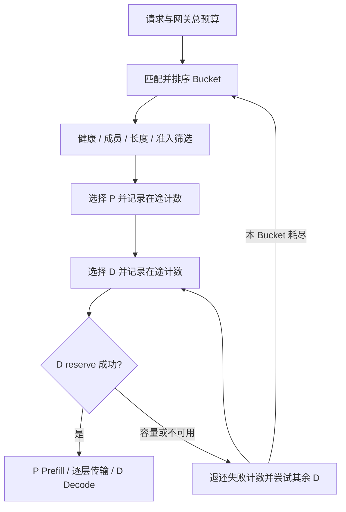

# P/D Worker 选择、准入与 KV 分配

路由参考相邻 SGLang `9f1a6dca98` 的 `buckets_reorg`、`policies_reorg` 和阶段负载排序，
适配本项目的单模型、TP=1 Worker 池。默认从随机选择改为 P/D 各自的 `power_of_two`。
Mooncake 的层组 event、后台 gather/RDMA、槽位 drain、多租约和异步安装继续独立运行。

## 何时选择

每个请求校验、分词并通过网关总预算后，执行一次 P/D 路由与 D 预留；成功后才向 P 发 Prefill。
因此逻辑上先选 P、再选 D，两个角色都确认后启动计算。不存在先算完 P 再决定 D 的流程。
请求进入计算后绑定固定 P/D，不在输出 token 后透明重放。



所有 Bucket 耗尽则请求失败；模型/协议/输入错误直接返回，不作为容量失败重试。
P 收到 Prefill 后若排队或容量拒绝，不自动换 P。首 token 已生成后保持原来的取消和传输排空规则。

## 1. Bucket 与健康筛选

未配置文件时使用覆盖所有请求、所有节点的默认 Bucket。`--bucket-config PATH` 的格式见
[2P/2D 示例](routing_buckets.json)，这是 mini-sglang 的配置格式，不能直接使用 SGLang 的配置文件。

- 输入长度须满足 `min_input_tokens <= prompt_len <= max_input_tokens`，未配置上限表示无限制。
- 全上下文须满足 `prompt_len + max_tokens <= max_context_tokens`；`max_tokens` 包含 P 的首 token。
- 匹配 Bucket 按 `min(max_input_tokens, max_context_tokens)`、`rank`、`id` 升序尝试，缺失上限视作无穷大。
- 每个 Bucket 可分别设置 `prefill/decode.worker_ids`、`policy`、`admission`。
  成员使用地址池顺序生成的逻辑 ID：`p-0`、`p-1`、`d-0`、`d-1`，不使用远端自行声明的自定义名称。
- 没有符合条件的 P/D 对时，退还本次 P 占用，再尝试下一个匹配 Bucket；跨 Bucket 共用已尝试 D 集合，不重复 reserve。

候选必须通过既有健康巡检：角色、multiplex v1、模型/KV 布局、传输模式、层组大小兼容，
没有退役/传输故障，且隔离字节不超过预算。模型身份在网关生命周期内固定。
还按 Worker 上报的最大序列和池总容量剔除明显放不下的请求；Bucket 上限不会扩大模型或显存池。
不健康节点仍被排除，负载指标缺失不会改变这一规则。

## 2. 每 Worker 准入

全部阈值默认关闭。Bucket 中未设置的阈值继承 CLI 全局默认；计数阈值必须为正整数，占用率为 `(0, 1]`。

| CLI / JSON 字段 | 达到或超过阈值即拒绝 |
|---|---|
| `--max-worker-inflight-requests` / `max_inflight_requests` | 本 Router 绑定到该 Worker、尚未结束相应阶段的请求数 |
| `--max-waiting-requests` / `max_waiting_requests` | Worker 上报的等待请求数 |
| `--max-pending-prefill-tokens` / `max_pending_prefill_tokens` | 排队中尚未计算、未命中缓存的 prompt token 数 |
| `--max-running-usage` / `max_running_usage` | 运行请求数 / 请求表容量 |
| `--max-kv-usage` / `max_kv_usage` | 私有或受保护 KV token 数 / KV token 容量 |

`--max-inflight-requests`、`--max-inflight-tokens` 仍是网关总预算，作用于整个请求；
新参数 `--max-worker-inflight-requests` 才是选路时的单节点限制，不能混用。
在途计数仅在短锁内选择/增减，不持有整请求锁，也不添加 `Semaphore(1)`，各 Worker 继续组批。
P 在 `sent` 或安全 `retired` 后释放路由计数；D 在客户端读完、取消或异常清理时释放。
这些计数不替代 Worker 对实际页、传输上下文和接收租约的计数。

负载随 health 快照上报，`--routing-load-max-age` 默认 6 秒，从 Router 收到健康报告时计时。
单次节点选择的准入和负载比较共用一份快照；Worker 快照可能滞后一个 GPU 调度周期。
缺失、非法或过期的指标视为未知，对相应外部阈值放行；本 Router 的在途计数始终有效。
路由只检查当前压力，不预留显存，也不保证新增请求后仍在阈值以下。
多个网关各自维护计数，Worker 的本地原子分配才是最终约束。

## 3. 默认两候选择优

在准入候选中随机抽两个不同节点，按以下顺序逐项比较，较小者胜出；只有一个候选时直接选它。
随机源仍使用 `--routing-seed`，并发到达和健康变化会影响具体分配。

| 角色 | 比较顺序 |
|---|---|
| P | 估计排队毫秒数（两者都有时）→ 待计算未缓存 token 数 → 等待请求数 → 运行请求数 → Router 在途数 |
| D | 等待请求数 → 运行请求数 → KV 占用率（两者容量已知时）→ KV token 数 → Router 在途数 |

必要的负载指标不完整或过期时，回退比较 Router 在途数；容量未知不当作容量为零。
Worker 的 P 时间估计来自已完成 Prefill batch 的每 token 耗时 EMA，冷启动前没有该估计。
测量复用原来的 batch 尾采样同步，不在层就绪回调增加同步。
KV 压力不计可淘汰的 Radix 前缀；实际分配仍可能为新请求淘汰这些缓存。

`--routing-policy` 控制 P，`--decode-policy` 控制 D，均默认 `power_of_two`。
两者也可选 `round_robin` 或 `random`，准入和健康筛选始终保留。
兼容参数 `--policy` 等价于 `--routing-policy`。Bucket 的角色策略可覆盖这些默认值。

## 4. 可选 P 缓存亲和

使用 `--routing-policy cache_aware`：

1. 在候选 P 的持久复用连接上并行发送只读 `prefix_match` 查询。
   GPU 调度线程读取本地 Radix 前缀长度，不分配 KV 页、不锁定前缀、不改变 LRU 或拆分节点。
   按页对齐查询 `prompt[:-1]`，至少保留一个待计算 token。
2. 筛选同时满足 `--cache-affinity-min-matched-tokens`（默认 1024）和
   `--cache-affinity-min-match-ratio`（默认 0）的命中节点，优先最长命中，长度相同时比较 P 负载。
3. `--affinity-mode prefer` 默认保留该选择；无有效命中时回退两候选择优。
4. `balanced` 模式再从其他可准入 P 中按负载选一个，比较
   `排队未缓存 tokens + 本请求未命中 tokens`。仅当缓存节点压力差大于
   `--affinity-load-gap`（默认 1024），且压力倍数大于 `--affinity-load-factor`（默认 2）时换到其他 P。

查询受 health timeout 约束；旧 Worker、不支持前缀复用的 cache、超时或查询失败按无命中处理，
不会仅因缓存查询失败退役健康 Worker。查询后重新做最终准入；缓存提示不保证之后仍然命中。
当前查询的是各 P 的本地 GPU 前缀，未实现全局 KV 索引、远端 DRAM/SSD 成本模型或跨 Worker 拉取前缀。
也未新增 SGLang 的 session affinity、SLO 偏好、多模型版本分组和自动发现。

## 5. D reserve 与实际页分配

选好 P/D 后先向 D 发原有 `reserve`。容量不足或退役/连接失败时退还该 D 的路由计数，
在当前 Bucket 剩余的健康且可准入 D 中重选；每个 D 对同一请求最多试一次，总重试不超过 M−1。
成功后再向 P 发 Prefill，保留同一请求的长连接与 `request_id` 分流。

| 时机 | 实际行为 |
|---|---|
| Worker 启动 | 创建模型 KV 池；Mooncake 预注册独立传输池 |
| 路由 | 长度、健康、当前负载筛选，不分配或承诺物理 KV 页 |
| D reserve | 可锁住 D Radix 前缀，按锁后容量检查 `align(prompt+输出)-命中前缀` 及现有未来预算；只分配后缀私有页和接收租约 |
| P 组批/前向 | PrefillManager 检查本轮 token、表行与页预算，前向前分配需要的页，暂时不足则排队 |
| D 安装/Decode | 安装 event 完成后归还接收租约并加入 continuous batch，输出页随 Decode 逐步分配 |

继续保留本项目的完整输出预算预留，未引入 SGLang 的延后 D 分配或 Decode 内存不足时 retract/re-prefill。
P 排队时 D 的预留继续占用；实际 `busy` 仍可能发生，不能用路由快照替代 Worker 的容量检查。
层组传输、EOS、取消、完成未知和安全排空详见[逐层传输](layered_transfer.md)。

## 使用与验证

启动器、网关和地址列表 Token ID 客户端共用上述参数。例如在原 2P/2D 命令上增加：

```text
--routing-policy cache_aware --decode-policy power_of_two
--affinity-mode balanced --max-worker-inflight-requests 32
--max-waiting-requests 64 --max-kv-usage 0.9
--bucket-config docs/pd/routing_buckets.json
```

`pd_route` JSON 日志包含 request_id、prefill_id、decode_id、bucket、角色策略、attempt 和 event。
CPU 回归入口为 `tests/integration/test_pd_policy.py`，并已加入 `tools/pd/test_phase2.sh`。
测试覆盖负载、准入、Bucket 回退、缓存查询、两种数据路径的参考 token、batch>1 和取消归还。
这些测试不能代替真实 GPU/RDMA 的重叠与性能验收。
