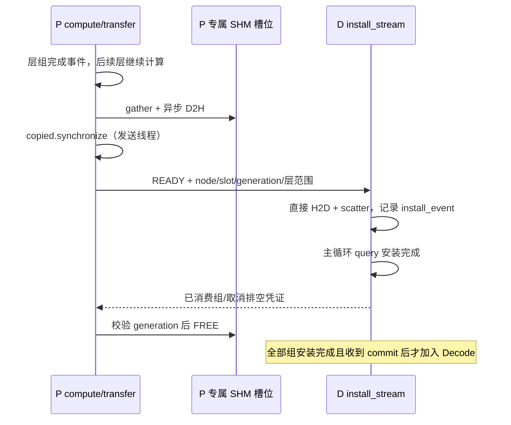

# 单机 NUMA 共享 Pinned DRAM 中转

`--pd-transfer-backend shm_dram` 是独立的单机 P→D 逐层后端，控制协议为
`shm-layered-dram-v3`。它不创建 Mooncake 主 TE，不使用 CUDA IPC event，也不改变
`dram_pool.py` 的完整 token 页布局或 D→P Host TE。`tcp`、Mooncake
`gpu_direct` / `host_dram` 的默认值和数据路径保持原样。

## 启动

```bash
PYTHONPATH=python python -m minisgl.disagg.launcher \
  --model /models/your-model \
  --num-prefill-workers 2 --num-decode-workers 6 \
  --pd-transfer-backend shm_dram \
  --pd-layers-per-chunk 1 --pd-staging-slots 3 \
  --pd-shm-overflow-slots 1 --pd-shm-local-wait-ms 1 \
  --pd-cross-numa-penalty 4 \
  --pd-max-transfer-bytes 1073741824 \
  --pd-max-registered-bytes 2147483648
```

需要 Linux POSIX SHM、libnuma、可用的 NUMA CPU/memory cpuset、足够的 `/dev/shm`
容量和 memlock 配额。`mbind(MPOL_BIND)` / `set_mempolicy` 或 `cudaHostRegister`
失败会显式报错。没有 pageable 或其他传输后端的静默回退；需要换用 `host_dram`
时应停止该集群并用 Mooncake 参数重新启动。当前支持 TP=1、MHA KV、单或双 NUMA。

启动器通过 GPU PCI BDF 的 sysfs `numa_node` 探测 NUMA，BDF 来自 `nvidia-smi`；
未知、缺失、`-1` 归零。测试/容器可以显式注入：

```bash
export MINISGL_GPU_NUMA_MAP='{"0":0,"1":0,"2":1,"3":1}'
# 等效启动器参数：--gpu-numa-map '{"0":0,"1":0,"2":1,"3":1}'
# 独立注入主机节点清单（含没有 GPU 的 CPU 节点）：
export MINISGL_NUMA_NODES=0,1
# 等效：--pd-shm-numa-nodes 0,1
```

未指定 P/D GPU 映射时，启动器跨节点混放角色：8 卡 2P6D 每路 1P3D；
4 卡 2P2D 每路 1P1D；4 卡 1P3D 在 NUMA 0 放 1P1D、NUMA 1 放 2D。
显式 GPU 映射优先，`--prefill-numa-nodes` / `--decode-numa-nodes` 可覆盖亲和节点。
Worker 在模型加载前执行 CPU 亲和及内存策略绑定。单 NUMA 所有 Worker 为节点 0。

## 容量与生命周期

启动器唯一拥有两块命名段 `<pool>_numa_0/1`（单路一块），每个 P 在本地段拥有
`--pd-staging-slots` 个主槽位，在对端段拥有 `--pd-shm-overflow-slots` 个溢出槽位。
溢出参数是**每个 P 的绝对槽位数**；单路禁用溢出。每个槽位保存一个层组和一个请求的
真实待传后缀，按 `[layer, K/V, token, head, dim]` 打包；它不是持久化 KV 缓存。

`host_staging_plan` 计算层组最大容量和 GPU scratch，使用 256 字节对齐。每个槽位另含
256 字节控制头，整段向 OS 页对齐。所有 Worker 映射并注册全部共享段，因此
`--pd-max-registered-bytes` 要覆盖**所有 P 的主槽位 + 所有溢出槽位 + 控制头 + 页对齐**，
不是只覆盖单个 P 的段。模型相关几何、注册预算和同机身份在加载权重前检查。
GPU scratch 只含一个层组和 token 索引，不把整个 SHM 容量从 HBM 预留扣除。
本地 DRAM 缓存的 `--pd-dram-cache-bytes` 独立计费。

启动器在绑定目标 NUMA 的辅助进程中对段执行 `mbind` 后 first-touch；各 Worker 独立
`cudaHostRegister(..., cudaHostRegisterDefault)`。命名段使用显式 `shm_open/shm_unlink`，
不受 Python resource tracker 的提前 unlink 影响。启动失败、正常退出、SIGINT/SIGTERM
和 atexit 清理先终止/等待所有 Worker，再 unlink 段和删除 manifest。
SIGKILL 或主机掉电不能执行用户态清理钩子；异常遗留段需确认没有进程使用后清理。

## 时序、溢出与安全边界



P 单一发送线程只分配自己的分区，无跨进程分配器锁。主槽位满时：

| 场景 | 行为 |
| --- | --- |
| 单 NUMA | 有界等待本地释放；不会覆盖在途槽位 |
| 双 NUMA，P/D 跨路 | 立即尝试 D 所在节点的专属溢出槽位 |
| 双 NUMA，P/D 同路 | 本地等待至 `--pd-shm-local-wait-ms`，再尝试对端溢出 |
| 主/溢出均满 | 发送线程轮询背压；到超时执行取消/排空握手 |

D 在保留 GPU 页后就能逐组安装，并在每组 H2D event 完成后确认归还。
安装直接从指定共享段读入 GPU，没有第二个 D Host receive 池或 CPU payload memcpy。
跨路 Host→GPU 的具体物理路径/带宽由机器 PCIe/NUMA 拓扑决定，需实测。
固定 GPU workspace 上的 scatter 仍是 GPU 内部的数据搬运。

取消先阻止新安装，清除尚未提交的 reader，等待已提交 H2D 排空，再释放目标 GPU 页并向 P
确认归还全部本地/溢出槽位。迟到消息必须匹配 request、slot 和 generation。
如果 CUDA event 或对端完成状态未知，则隔离槽位并停止该 Worker，保留映射/页直至进程退出；
超时不是 DMA 完成凭证。Router 的 Hint 不改变 D reserve 返回的真实 `d_prefix_len`；
全前缀命中不建立层传输任务，也不写 SHM。

`LayeredReceiveTicket` 仍为 v3、`KVTransferMetadata` 仍为 v2。SHM 模式 ticket 的
`address=1` 是满足旧结构校验的占位值，不用于解引用；实际定位由同机 manifest、
专属分区、slot 和 generation 决定。

## 选路与验收

`power_of_two`、`cache_aware`（含 `affinity-mode=balanced`）在双 NUMA 下使用同机、同共享池
的可接纳 P/D 配对。跨路成本 `--pd-cross-numa-penalty` 以毫秒等价成本计入选择；
负载增加或高比例前缀复用可以抵消该惩罚。单 NUMA 保持原缓存/负载选择与随机种子行为。
负载仍是健康快照估计，不是硬件带宽测量或容量保证；最终以 Worker reserve 为准。

CPU 测试在 `tests/disagg/test_shm_relay_pool.py` 与 `tests/integration/test_pd_shm.py`。
它们使用真实 POSIX 段、多个进程、本机 socket、CPU KV/scatter 和模拟 CUDA fence。
CPU 测试不会证明 CUDA 驱动能双进程注册同一物理页，也不会证明真实跨路带宽或流重叠。

真机预检：

```bash
PYTHONPATH=python python tools/pd/verify_shm_dram.py \
  --prefill-gpu 0 --decode-gpu 4 --bytes 33554432 --iterations 30
```

脚本严格 first-touch/mbind，让两个独立 CUDA 进程同时保有所有段的 Host 注册，
用进程内 CUDA event 完成屏障、控制管道传递通知，校验数据，输出每个 NUMA 段到各 GPU
的本地/跨路 D2H/H2D CUDA event 中位带宽及包含提交/等待开销的 wall 带宽。
它测量原始 copy；模型端到端数值、TTFT/TPOT、gather/scatter 开销、持续并发、NUMA 实际驻留
和不同驱动/拓扑支持仍需后续真机验收。
