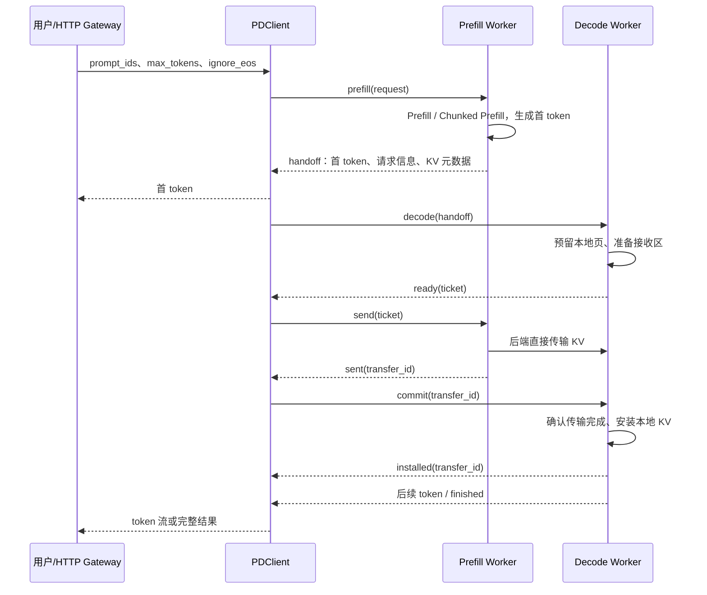

**项目交接文档：Mini-SGLang P/D 分离与 Mooncake GPU 直传改造**

- 编写日期：2026-11-22，Asia/Shanghai。
- 项目目录：`/home/wty238388/ai-infra/MoonCakeSGlang/mini-sglang`。
- 当前分支及 HEAD：`main`，`fda55e3`；相对 `origin/main` 领先 1 次提交。
- 本地记录的官方基线：`9a91cfafe754aa85daee49998176275667eb58f2`，远端为 `https://github.com/sgl-project/mini-sglang.git`。
- 取证范围：README、依赖配置、最近 20 次提交、当前工作区源码、现有测试及本地 JUnit 报告。本次交接整理未启动服务、安装依赖或执行测试。

**当前进度判断：P/D 的 CPU/TCP 路径已有历史验证记录；Worker 内持有 Transfer Engine 的 GPU/RDMA 改造已写入工作区，但尚未完成运行验收。** 后续主体包含大量未提交、未追踪文件，仅克隆或检出当前 HEAD 无法恢复本文描述的完整系统。

# 1. 项目概览

## 1.1 核心定位与目标

本项目以官方 Mini-SGLang 为基础，将原有 Unified 大模型推理引擎扩展为可独立部署 Prefill Worker 和 Decode Worker 的系统，并通过 Mooncake Transfer Engine 实现两端 GPU KV Cache 的直接网络交接。

当前目标是先建立可审查的请求协议、正确的续算结果和可靠的资源生命周期，再推进 GPU/RDMA 验收、并发调度与性能优化。当前代码尚不能作为已经完成双机高吞吐验收的生产版本。

## 1.2 项目与相邻仓库的关系

| 目录/资料 | 作用与使用边界 |
|---|---|
| `mini-sglang/` | 本次交接的运行代码、测试和工具所在仓库。 |
| `../Mooncake/` | 独立 Mooncake 源码仓库，用来核对原生接口、构建所需 Python 扩展；不是复制到 Mini-SGLang 内的源码子目录。 |
| `../codex交接文档/fluxinfer_phase*/` | 阶段移植材料与历史方案。用于理解设计来源，不能替代当前工作区源码和运行验证。 |
| [README](../README.md) | 主要描述上游 Unified 引擎、安装和 Benchmark。H200 性能图属于上游结果。 |
| [Phase 2 报告](../docs/pd/phase2.md)、[移植说明](../docs/pd/phase2_porting.md) | TCP/CPU 参考路径的阶段资料；报告中的开发基线与本地提交历史不同。 |
| [Mooncake GPU 直传说明](../docs/pd/mooncake_direct.md) | 当前去 helper、GPU/RDMA 改造的专项说明，应与对应源码一起阅读。 |

Mini-SGLang 运行时导入的是安装环境中的 `mooncake.engine` 扩展。若安装包已经具备所需原生接口，则运行不要求保留 Mooncake 源码目录；但当前新接口是否被已发布 wheel 包含，必须实际核实，不能仅凭包名判断。

## 1.3 技术栈与环境依赖

| 层次 | 技术与约束 |
|---|---|
| 运行平台 | Linux，x86_64/aarch64。普通 CUDA 环境与 GPUDirect RDMA 环境需要分别验证，README 的 WSL2 说明不能视为 RDMA 支持证明。 |
| Python | 声明支持 Python ≥3.10；本地开发环境使用 Python 3.12，建议接手时沿用该版本减少差异。 |
| 推理 | PyTorch `<2.10.0`、Transformers `>=4.56.0,<=4.57.3`、真实 safetensors 权重；CUDA Toolkit、驱动及相应 GPU 算子。 |
| 算子 | FlashInfer `>=0.5.3`、`sgl_kernel`、TVM FFI、项目内 C++/CUDA JIT 算子；另有 FlashAttention、TensorRT-LLM attention 后端选择。 |
| 服务/进程通信 | FastAPI、Uvicorn、pyzmq；Unified 使用多进程与 TP 通信，P/D 控制使用自定义 TCP/JSON 协议。 |
| KV 管理 | PyTorch Tensor、分页 KV 池、请求页表、Radix/Naive 前缀缓存。 |
| Mooncake 直传 | `pd-mooncake` extra 声明 `mooncake-transfer-engine==0.3.12.post1`、`cuda-bindings>=12.9,<14`；还需要支持 GPU 内存注册的 RDMA NIC、驱动与 GPU/NIC 拓扑。 |
| 测试/开发 | pytest、pytest-cov、标准库 unittest；uv 管理虚拟环境。完整依赖见 [pyproject.toml](../pyproject.toml)。 |

本地现存 `.venv` 是 CPU 测试环境：元数据显示 `torch 2.9.1+cpu`、`transformers 4.57.3`、`pytest 9.2.0`，未发现 Mooncake 和 cuda-bindings 的安装元数据。它不能直接承担 GPU/RDMA 验收。

# 2. 核心架构与模块划分

## 2.1 Unified 请求链路

```text
HTTP/OpenAI 请求
  → FastAPI
  → tokenizer 进程
  → ZMQ 消息
  → Scheduler：前缀匹配、Prefill/Decode 组批、分配 KV 页
  → Engine：模型前向、attention、采样
  → detokenizer 进程
  → 非流式 JSON / SSE
```

[总入口](../python/minisgl/__main__.py) 调用 `server.launch.launch_server()`。默认 `worker_role=unified`，由启动器创建计算和分词进程；`num_tokenizer=0` 时分词/反分词共用 detokenizer 进程，配置 `num_tokenizer>0` 后另建 tokenizer 进程。TP 模式为每个 rank 创建 Scheduler。

Unified 的 `Scheduler.overlap_loop()` 通过 CUDA stream 协调当前批次执行与上一批结果处理；`normal_loop()` 是关闭重叠后的执行路径。当前组批策略优先 Prefill，再调度 Decode，不能把这一能力直接等同于 split Worker 的执行模式。

## 2.2 P/D 请求链路与控制协议



若首 token 已满足 `max_tokens` 或触发 EOS，请求不再进入 D 端续算。首 token 由 P 生成，D 从其后的 token 开始计算，客户端负责输出顺序和预算一致性。

`PDClient` 是控制协调器：向 P 提交请求、校验 handoff、把 handoff 交给 D、把 ticket 交回 P、等待 `sent` 和 `installed`，再接收 Decode 输出。**完整 KV payload 不经过 PDClient。** `commit` 是应用协议中的安装确认请求，与 Git commit 没有关系。

`PDClient.__init__(prefill, decode)` 固定两个端点，当前没有服务发现、动态选 Worker 或负载均衡。Worker 主推理循环串行处理连接；后端控制线程与资源回收线程的并发不代表多个请求同时进行模型前向。

## 2.3 两种 KV 数据路径

| 后端 | 实际路径 | 当前定位 |
|---|---|---|
| `tcp`，默认 | P KV 池 → CPU 字节 payload → Worker 间 TCP → CPU 接收区 → D KV 池 | 可测试的正确性参考路径，保留长度、SHA-256 和接收凭据校验。 |
| `mooncake` | P GPU KV 池 → 独立连续 GPU Tensor → Mooncake/RDMA → D 独立 GPU Tensor → D GPU KV 池 | 当前新增路径；没有 CPU KV 暂存，但保留两端 GPU 打包/安装拷贝，尚未硬件验收。 |

每个 Mooncake Worker 在本进程持有一个长期存在的 `TransferEngine`，不再使用 helper 子进程。Engine 先初始化 CUDA、加载模型，之后后端绑定同一设备并创建 TE；这样避免提前初始化 CUDA 破坏原有 Engine 初始化约束。

Mooncake 后端仍通过 TCP 交换控制消息、接收地址描述、长度和终态确认；KV 字节交给 TE。这里的“GPU 直传”不意味着直接写入 D 最终页地址，也不意味着整个请求完全不使用 CPU。

## 2.4 关键目录与核心文件

| 模块/文件 | 关键代码与职责 |
|---|---|
| [core.py](../python/minisgl/core.py) | `Req`、`Batch`、`SamplingParams`、`Context`：请求长度、批次与模型执行上下文。 |
| [server/args.py](../python/minisgl/server/args.py) | `ServerArgs`、`parse_args()`：Unified/P/D 参数、前置约束和 GPU 传输资源预算。 |
| [server/launch.py](../python/minisgl/server/launch.py) | `launch_server()`：Unified 多进程启动，以及 split 角色的专用分派。 |
| [server/api_server.py](../python/minisgl/server/api_server.py) | 原 Unified HTTP API、流式输出和请求转换。 |
| [scheduler/scheduler.py](../python/minisgl/scheduler/scheduler.py) | `_schedule_next_batch()`、`_prepare_batch_metadata()`、`_forward()`、`overlap_loop()`：调度与执行主干。 |
| [scheduler/prefill.py](../python/minisgl/scheduler/prefill.py)、[decode.py](../python/minisgl/scheduler/decode.py) | `PrefillManager`、`ChunkedReq`、`DecodeManager`：分块预填充与逐步续算。 |
| [scheduler/cache.py](../python/minisgl/scheduler/cache.py) | `allocate_paged()`、`reserve_import()`、`discard_private()`：普通页分配、接收页预留、异常回滚。 |
| [scheduler/table.py](../python/minisgl/scheduler/table.py) | `TableManager`：请求表行、token pool 与页表索引管理。 |
| [kvcache/mha_pool.py](../python/minisgl/kvcache/mha_pool.py) | `MHAKVCache`；CPU `export_tokens/import_tokens` 与 GPU `export_tensor/import_tensor`。 |
| [kvcache/radix_cache.py](../python/minisgl/kvcache/radix_cache.py)、[naive_cache.py](../python/minisgl/kvcache/naive_cache.py) | 前缀匹配、引用保护与驱逐；Naive 实现不支持驱逐。 |
| [engine/engine.py](../python/minisgl/engine/engine.py)、[config.py](../python/minisgl/engine/config.py) | 模型、attention、KV 池、CUDA Graph 初始化；`_determine_num_pages()` 计算页预算并预留传输显存。 |
| [engine/graph.py](../python/minisgl/engine/graph.py)、[sample.py](../python/minisgl/engine/sample.py) | CUDA Graph 与采样。Split 路径当前关闭 Graph，使用 greedy。 |
| `python/minisgl/models/`、`layers/`、`attention/`、`kernel/` | 模型结构、权重加载、并行层、attention 后端和 JIT 算子。 |
| `python/minisgl/tokenizer/`、`distributed/`、`message.py` | 文本/Token 转换、TP 通信和 Unified 消息类型。 |
| [disagg/protocol.py](../python/minisgl/disagg/protocol.py) | `KVLayout`、`KVTransferMetadata`、`RequestHandoff`、`ReceiveTicket`：跨进程数据契约与校验。 |
| [disagg/lifecycle.py](../python/minisgl/disagg/lifecycle.py)、[role.py](../python/minisgl/disagg/role.py) | 请求状态迁移、取消/失败终态、角色约束。 |
| [disagg/control.py](../python/minisgl/disagg/control.py) | `Channel`、`StartRequest`：带长度前缀的 JSON 控制帧、超时、断连与取消检测。 |
| [disagg/transfer.py](../python/minisgl/disagg/transfer.py) | 后端接口、Mock 参考实现、传输异常与 `TransferBackendUnavailable`。 |
| [disagg/backend.py](../python/minisgl/disagg/backend.py) | `create_transfer_backend()`：按参数延迟选择 TCP/Mooncake；TCP 使用者无需导入 Mooncake 扩展。 |
| [disagg/tcp_backend.py](../python/minisgl/disagg/tcp_backend.py) | `TcpTransferBackend`：真实 socket 数据传输、撤销、接收确认和内容校验。 |
| [disagg/worker.py](../python/minisgl/disagg/worker.py) | `PDWorkerScheduler.prefill/decode/_release()`、`serve_worker()`、`launch_split_worker()`：P/D 计算与资源主路径。 |
| [disagg/client.py](../python/minisgl/disagg/client.py)、[gateway.py](../python/minisgl/disagg/gateway.py) | `PDClient.stream/generate()` 与 HTTP 网关；前者返回 Token ID，后者负责分词、文本和 SSE。 |
| [disagg/mooncake_backend.py](../python/minisgl/disagg/mooncake_backend.py) | GPU 接收票据、地址握手、`send/finish_receive/discard_receive/close` 与跨端收尾。 |
| [disagg/mooncake_runtime.py](../python/minisgl/disagg/mooncake_runtime.py) | TE、Tensor 注册、原生操作 ticket、后台 drain、隔离和资源预算。 |
| [disagg/cuda_transfer.py](../python/minisgl/disagg/cuda_transfer.py) | CUDA Driver API：设备地址检查、同步属性和 RDMA 写入可见性。 |
| `tests/disagg/`、`tests/integration/` | 协议/后端测试及入口、缓存、CPU 两进程续算、故障和 HTTP 集成测试。 |
| `tools/pd/`、`benchmark/` | 阶段验收脚本、Unified/TCP GPU 对照和上游性能脚本。 |

`python -m minisgl.disagg` 只运行标准库协议/Mock 冒烟，并不加载模型。真实 Worker 使用 `python -m minisgl --worker-role prefill/decode`。旧 `mooncake_agent.py` helper 入口已从当前实现移除。

## 2.5 内存与资源生命周期

1. `MHAKVCache` 的物理布局为 `[K/V, layer, page, page_size, local_kv_heads, head_dim]`。每个请求通过本机页表定位 slot；传输元数据保留逻辑顺序，不能把 P 的物理页编号直接当成 D 的页地址。
2. P 使用前缀缓存与 PrefillManager 完成计算，取出 prompt 对应 KV。GPU 路径打包为独立 Tensor，完成生产该副本的 CUDA 工作后，原请求页才能缓存或归还；网络传输不再依赖原页继续占用。
3. D 的 `reserve_import()` 分配自己的私有页，接收 Tensor 与目标 KV 页是两类资源。收到完成证明后才把接收 Tensor scatter 到本地 slots，同步完成后再丢弃接收 Tensor并开始 Decode。
4. `_release(cache=...)` 先同步请求的 GPU 工作，再移出管理器、缓存或丢弃私有页、释放请求表行。异常路径不得把借用的 Radix 前缀页当作私有页释放。
5. dummy 页/行供 padding 等内部用途使用，不能导出、覆盖或计入可交付的 KV slots。普通分配失败与导入失败需要回滚，避免“分了页但未安装”的泄漏。

GPU 传输还必须满足以下不变量：

| 对象/状态 | 释放条件与当前处理 |
|---|---|
| 已注册源/接收 Tensor | Python 强引用由 runtime 保持；CUDA 生产、原生访问、注销的完成条件必须分别满足。 |
| 正常传输完成 | 原生完成后再执行 D 端 CUDA 可见性处理；随后安装 KV，按所有权释放注册与 Tensor。 |
| 业务取消/控制断连 | 撤销本次请求的交付资格；不能据此推断 DMA 已停止，晚到完成不能重新安装到已取消请求。 |
| `COMPLETION_UNKNOWN` | 保留 ticket、Tensor 和注册，后台继续 drain；禁止普通 `finally` 直接释放或复用地址。 |
| `FAILED_DRAINED` | 只证明 P 本地操作排空，不能批准 D 端可能仍被远端访问的接收区释放；D 必要时保持隔离。 |
| 注销失败/资源超限/隔离超期 | 无法证明安全的对象继续保留，后端停止接收新工作；必要时 Worker 非零退出，交给外部进程监管重启。 |

`output.copy_done_event.synchronize()` 等待该次输出 token 的 GPU→CPU 拷贝完成，保证主机读取 token 安全；它不是将 KV 移到 GPU 的操作。该事件等待也不等价于所有 RDMA 操作完成。

# 3. 目前已实现的核心功能

## 3.1 已有验证记录的本地 P/D 功能

以下功能有此前 CPU/TCP 测试覆盖，验证时间早于最新 GPU/RDMA 改造。它们说明参考路径曾跑通，不能直接证明当前整个工作区已通过回归。

| 功能 | 作用及验证范围 |
|---|---|
| Handoff/票据协议 | 序列化请求、KV 布局、token 预算、EOS 和传输凭据；拒绝非法布局、越界、错误状态和不匹配请求。 |
| 角色与专用入口 | 默认 Unified；合法 split 请求进入 `PDWorkerScheduler`。不支持的 TP、dummy 权重、shell 等配置在加载模型前尽量拒绝。 |
| 真实 TCP KV 交接 | 两端后端直接传输 payload，PDClient 仅协调控制；覆盖重复、撤销、部分帧、校验失败、帧限制和断连。 |
| CPU 两进程续算 | `TinyEngine` 驱动真实调度器、KV 池和页表，P/D 经实际 TCP 交接后与参考 token 序列比较。它是确定性小 attention 模型，不是下载的大模型。 |
| 分页导入与异常回滚 | 覆盖多 dtype、稀疏 slots、dummy 页保护、分配失败回滚及 Radix 借用页保护。 |
| 请求故障清理 | 注入前向、元数据、接收准备、KV 安装和布局失败，检查请求私有页与表行回收。 |
| HTTP 网关基本行为 | 提供非流式、SSE、EOS/length 结束原因、错误与断连取消；现有网关测试主要使用桩客户端/分词器，并非真实 GPU 模型 HTTP 验收。 |

证据：`.venv/phase2-tests.xml` 的测试时间为 **2026-11-21 21:41，+08:00**，记录 0 failures、0 errors、1 skipped；对应历史汇总为 **105 passed、1 skipped、101 subtests passed**，耗时约 41.691 秒。XML 的 `tests=207` 含子测试记录，不应解释为 207 个独立测试函数。

唯一 GPU 测试跳过要求 CUDA、完整依赖和 `FLUXINFER_PD_GPU_MODEL`。另一份 `.venv/pytest-pd-tests.xml` 是更早的部分测试报告。报告位于通常不入 Git 的虚拟环境中，交接时需归档，且不能将它们绑定到后续未提交改造作为验收证明。

## 3.2 继承自官方的引擎能力

- **Unified 连续组批与 Chunked Prefill**：组合多个请求，分块处理长 prompt，并维护 Decode 活跃请求。当前本地没有重新执行完整 GPU 性能验收。
- **Radix 前缀复用与分页 KV 池**：锁定正在借用的前缀，管理可驱逐页与空闲页，减少重复计算和显存碎片；P/D 另外增加导入页与私有页释放路径。
- **CUDA Graph、CPU/GPU 调度重叠与 TP**：属于 Unified 路径已有能力；split Worker 当前主动关闭 Graph/重叠并限制 TP=1。
- **多模型与 attention 后端**：源码有 Llama、Qwen2、Qwen3、Qwen3MoE、Mistral 及多种 attention 实现。模型代码存在不等于各模型已通过新的 P/D/RDMA 兼容验收。
- **OpenAI 风格接口和离线调用**：保留原 Unified 服务、交互入口与 Benchmark；独立 P/D 网关只实现其中的 greedy 子集。

## 3.3 已实现、尚待运行验收的 GPU/RDMA 功能

- **Worker 内原生 TE**：去除 helper 和本机 KV 中转，延迟加载 `mooncake.engine`，Engine 初始化后在相同 GPU 上创建 TE。
- **同设备 KV 打包/安装**：`export_tensor/import_tensor` 保持 payload 在 GPU，支持未量化 FP16/BF16/FP32；D 接收字节 Tensor 后按目标 dtype 解释，而非数值转换。
- **RDMA/CUDA 条件检查**：要求 CUDA 原生扩展和明确的完成状态接口，检查设备地址及可用 HCA，拒绝冲突传输配置；失败不会静默回退到 CPU/TCP/helper。
- **完成检测与延迟回收**：维护 `RegisteredBuffer`、`TransferOperation`，对取消和未知完成保留对象，后台 drain 并通过独立控制连接处理终态收尾。
- **GPU 可见性处理**：按设备能力检查同步属性与 GDR 写入顺序，必要时执行写入 flush 和上下文同步，再由 D 消费数据。
- **资源上限与健康状态**：对注册字节、注册区数量和隔离年龄设限，Engine 预留相应显存；健康信息包含 TE 来源、session 和资源状态。

上述结论来自源码和此前静态语法/差异检查，**尚无原生接口执行、GPU 字节对照、双机 RDMA、取消竞态或显存回收的通过记录**。

# 4. 近期核心修改与重构记录

## 4.1 最近 20 次 Git 提交

检索范围为 `git log -20`。其中仅第一条为本地 P/D 提交，其余 19 条属于当前 `origin/main` 及其官方祖先，不能全部归为本地近期重构。

| 提交 | 日期 | 来源与实质变化 |
|---|---|---|
| `fda55e3` | 2026-11-21 | 本地：新增 P/D 数据契约、生命周期、角色、Mock 和独立冒烟入口；共 6 文件、515 行新增。 |
| `9a91cfa` | 2026-05-17 | 官方：稳定 TP 各 rank 的 Decode batch 顺序，避免不同 rank 的请求顺序不一致。 |
| `490fbdf` | 2026-05-17 | 官方：修复 Benchmark OpenAI 客户端凭据配置。 |
| `85a423f` | 2026-05-17 | 官方：支持 `/v1/chat/completions` 的 `stream=false`。 |
| `2a982af` | 2026-05-10 | 官方：清理 shell 中未使用的代码。 |
| `5ae38fc` | 2026-05-10 | 官方：解释调度元数据 `write_tuple` 的 `-1` 哨兵。 |
| `ba3b55c` | 2026-05-10 | 官方：Radix 父节点拆分后更新时间戳，修正后续驱逐依据。 |
| `20fcd7f` | 2026-03-13 | 官方：修复 FlashInfer 后端竞态，涉及 attention、环境和调度路径。 |
| `db31896` | 2026-03-12 | 官方：整理权重加载实现。 |
| `7b670a2` | 2026-03-12 | 官方：新增 Mistral dense 支持。 |
| `0e30e01` | 2026-03-12 | 官方：Qwen3 TP=8 与权重流式加载优化。 |
| `6737332` | 2026-03-10 | 官方：格式与检查整理。 |
| `1bdd8d5` | 2026-03-10 | 官方：使用流式权重加载修复 TP 模式加载 OOM。 |
| `3d2242c` | 2026-03-10 | 官方：格式与检查整理。 |
| `7c59f4d` | 2026-03-10 | 官方：修复 batch>1 时 LM head all-gather 输出 reshape。 |
| `c7f800d` | 2026-02-26 | 官方：代码风格整理。 |
| `690f55a` | 2026-02-26 | 官方：修复未初始化随机种子导致的采样不一致。 |
| `7087e14` | 2026-02-25 | 官方：降低权重加载延迟。 |
| `64060c2` | 2026-02-25 | 官方：增加基于 WildChat 的离线 Benchmark。 |
| `dae78f6` | 2026-02-22 | 官方：修复 `page_size>1` 时的缓存驱逐。 |

## 4.2 尚未形成 Git 提交的本地改造

以下依据工作区源码和与官方基线的差异归纳，时间顺序来自阶段材料与会话过程，不是新增 Git 提交记录。

| 改造 | 主要文件 | 原因与影响 |
|---|---|---|
| split 角色接入启动器 | `server/args.py`、`server/launch.py`、`scheduler/config.py`、`scheduler/scheduler.py` | 保留默认 Unified，同时提供真正 P/D 专用启动路径；防止错误角色绕过检查直接构造普通 Scheduler。 |
| TCP 控制/数据面与客户端 | `disagg/control.py`、`tcp_backend.py`、`client.py` | 将 P/D 计算、请求协调和 KV 传输分开；从 Mock 契约推进到真实跨进程网络续算。 |
| 接收端页分配与私有页回收 | `scheduler/cache.py`、`worker.py` | D 必须拥有自己的物理页；失败时回滚私有资源并保留借用前缀，避免泄漏、双重释放及前缀损坏。 |
| 复用调度元数据准备 | `scheduler/scheduler.py`、`worker.py` | 将批次元数据准备与普通页分配分开，允许 D 使用已预留/导入的页，避免重复分配。 |
| KV CPU 导入导出与布局校验 | `kvcache/mha_pool.py`、`disagg/protocol.py` | 保持 token 顺序并校验 dtype、模型、层/头维度、页大小、范围和 dummy 页。 |
| 独立 HTTP 网关 | `disagg/gateway.py` | 将 HTTP、分词和 Token 流转换放在计算 Worker 之外，提供 SSE、取消和错误转换。 |
| 阶段测试与验收工具 | `tests/disagg/`、`tests/integration/`、`tools/pd/` | 建立 CPU 参考模型、真实 TCP 交接与故障注入，另保留显式 opt-in 的 GPU/TCP 对照。 |
| 去 helper，Worker 内持有 TE | `disagg/mooncake_backend.py`、`mooncake_runtime.py`；移除旧 `mooncake_agent.py` | 减少额外进程和本机 KV 中转，把原生引擎与 GPU 注册生命周期归入 Worker；同时增加进程内未知完成的管理责任。 |
| GPU→GPU payload | `mha_pool.py`、`worker.py`、`cuda_transfer.py` | 用设备上连续 Tensor 替代 CPU KV 字节；明确 CUDA 生产、RDMA 完成、GPU 可见性和安装完成之间的顺序。 |
| 原生资源隔离与退役 | `mooncake_runtime.py`、`mooncake_backend.py`、`transfer.py` | 业务超时不能证明原生访问结束；对未知状态保留地址和 ticket，设置预算/超龄阈值，避免晚到写入损坏后续请求。 |
| 为传输保留显存 | `engine/config.py`、`engine/engine.py`、`server/args.py` | 防止模型和 KV 池占满显存后无空间创建收发副本；自动页数扣除预算，显式页数也做上限检查。 |
| 可选原生依赖 | `pyproject.toml`、`disagg/backend.py` | TCP 使用者无需安装 Mooncake；启用直传时再检查 CUDA 扩展能力，降低对参考路径的影响。 |

实际新增主体含未追踪文件，因此 `git diff --stat` 不能完整表示交付范围。正式接手前必须同时核对 `git status --short`、已追踪差异和未追踪文件清单。

# 5. 未决问题与 TODO 列表

## 5.1 源码明确标记的待办

| 位置 | 待办与影响 |
|---|---|
| [kvcache/base.py](../python/minisgl/kvcache/base.py) | `TODO: support HiCache`，尚无该层的完整分层缓存实现。 |
| [kvcache/__init__.py](../python/minisgl/kvcache/__init__.py) | 支持 MLA 等其他 KV 池；当前 split 明确依赖 MHA 布局。 |
| [tokenizer/tokenize.py](../python/minisgl/tokenizer/tokenize.py) | 批量 tokenization，当前仍有 CPU 分词优化空间。 |
| [scheduler/prefill.py](../python/minisgl/scheduler/prefill.py) | host cache match 与更准确的预算估计策略。 |
| [scheduler/scheduler.py](../python/minisgl/scheduler/scheduler.py) | Decode-first 等其他调度策略。 |
| [server/api_server.py](../python/minisgl/server/api_server.py) | 扩展采样参数处理。 |
| [attention/fa.py](../python/minisgl/attention/fa.py) | Blackwell 上的 FA4 支持。 |

未检索到额外明确标记的 `FIXME`。`NotImplementedError` 不能一律视为 Bug：IO/环境基类中的方法是接口占位，`ChunkedReq` 禁止直接采样属于保护条件；但 `RadixManager.reset()` 确实未实现，NaiveCache 也不支持驱逐，调用者应遵守其边界。

## 5.2 当前限制、已知缺口与需关注的问题

| 类别 | 当前事实 | 对接手工作的影响 |
|---|---|---|
| 原生依赖缺口 | 当前 CPU `.venv` 没有所需 GPU/Mooncake 环境；包版本不保证新 Scatter 接口存在。 | GPU 启动前先解决扩展来源和能力，不应直接归因为 Python 控制逻辑故障。 |
| GPU/RDMA 验收缺口 | 尚无真实 GPU payload 字节、RDMA 路径、跨服务器 token 和异常生命周期验证。 | 是当前最高优先级，不能沿用旧 CPU 测试结果发布功能完成结论。 |
| 新路径测试缺口 | 没有 Mooncake 专项测试；现有 `verify_phase2_gpu.py` 固定默认 TCP，没有 `--backend` 参数。 | 旧 GPU 脚本只能验证 GPU 计算配合 TCP 交接，无法验收新的 TE 路径。 |
| 并发/重叠限制 | 每个 split Worker 串行服务，TP=1、greedy、eager、Graph/overlap 关闭。 | TE 原生操作可以异步提交，当前请求主路径仍等待传输与安装；不能承诺计算和传输重叠。 |
| 单 GPU 部署限制 | P/D 即使放在同一块卡上也分别加载模型、分配 KV 池与传输副本。 | 内存需求明显增加；同卡实验不代表双机 RDMA 和吞吐收益，需独立评估。 |
| 显存开销 | GPU 打包/安装仍有副本，按请求注册/注销也有开销；attention、页表和算子工作区还要占用显存。 | `memory_ratio` 与传输预算必须结合真实峰值测量，静态扣除预算不等于所有配置都不会 OOM。 |
| 异常时服务退役 | 完成未知、注销失败或终态收尾丢失会保留注册；隔离超期/预算耗尽可触发 Worker 退出。 | 这是保守生命周期策略，需进程监管、退出码处理和重启方案；不能改成超时后直接 free。 |
| 收尾可靠性边界 | 补偿终态回执有界且只做有限次尝试，丢失后可能持续隔离直至退役。 | 需注入断连/丢回执验证安全与可恢复性，并决定是否增强重试/确认机制。 |
| 运行时内容校验差异 | TCP 有 CPU SHA-256；GPU 直传当前没有同等的完整 payload SHA-256。 | 现阶段依赖布局、长度和原生完成等检查；需用 GPU 字节对照补充验收，不应宣称两条路径校验等价。 |
| 控制与部署边界 | 无多 P/D 发现、负载均衡、故障迁移；自定义协议未提供认证/TLS。 | 当前应按固定端点、受控网络部署；如需生产服务，需要另行定义访问边界和调度层。 |
| 健康探测限制 | Worker 主连接处理串行，繁忙时新 health 连接可能等待当前请求结束。 | 探测超时不一定等于后端失效，监管参数需结合该行为设计。 |
| 历史工具缺失引用 | `tools/pd/verify_sources.py` 引用的 `docs/pd/phase0.md` 在当前仓库缺失。 | 工具不能按原样完成全部校验，需要补齐资料或修正引用。 |
| 文档时效 | 阶段包旧 helper 描述、`tests/disagg/文件介绍.md` 中 split 未实现的说法已过时。 | 以当前入口、代码和本交接状态为准，后续安排统一文档。 |

目前没有新增硬件实测数据可据以确认具体 GPU/RDMA Bug；以上把确认的边界、测试缺口和待测风险分开列出。不要把缺少运行证据写成“已验证没有问题”。

## 5.3 建议下一步优先级与完成标准

| 优先级 | 工作项 | 完成标准 |
|---|---|---|
| P0 | 固化交付与环境 | 完整审查并保存当前已追踪/未追踪代码；记录 commit、依赖锁定、扩展构建来源及硬件信息，确保其他机器可复现。 |
| P0 | 核实原生 CUDA 接口 | 在目标环境确认 `SUPPORT_CUDA`、`submit_scatter_write`、ticket `drain` 与三态完成接口；记录实际扩展文件和 Mooncake 源码版本。 |
| P0 | 新 GPU 数据路径验收 | 覆盖 FP16/BF16/FP32、稀疏 slots、页大小、dummy 页；直接比较 GPU 接收/安装内容，并验证真实 RDMA 路径及无 CPU KV 暂存。 |
| P0 | 模型输出对照 | 相同权重、prompt、greedy 参数下，在独立进程比较 Unified/P/D token；分别进行单机双 GPU和双服务器验收。 |
| P0 | 故障与生命周期验收 | 覆盖注册/注销失败、提交失败、完成未知、取消、控制断连、晚到写入、重复终态、收尾丢失、关闭和预算耗尽；证明取消后不安装、未知地址不复用、资源有界。 |
| P0 | 监管与内存验收 | 测量长期循环下显存/注册区变化；验证正常退出及不可恢复时非零退出，补充 Worker 重启操作说明。 |
| P1 | 测量并优化开销 | 建立 TTFT、TPOT、吞吐、KV 传输时间和显存峰值基线；再评估注册缓冲池、减少打包拷贝与 CUDA 全局同步的收益。 |
| P1 | 并发与计算/传输重叠 | 明确多个在途请求的页/Tensor 所有权，支持异步完成驱动的调度；在正确性通过后用性能数据证明重叠效果。 |
| P1 | 多 P/D 管理 | 加入服务发现、容量/负载选择、请求准入和健康模型；设计连接与回收压力边界。 |
| P2 | 扩展模型/布局 | 规划 TP>1、其他 KV 布局、量化、更多采样与推测解码等。当前没有足够证据将 FP8、EAGLE 或 MLA 列为本地已实现功能。 |

## 5.4 需要负责人人工补充/确认

- **[待人工确认：原生扩展]** 目标机器安装的 wheel 是否包含本项目依赖的新接口？由哪个源码 commit 构建、启用了哪些 CUDA/RDMA 选项、产物保存在哪里？本地核对参考为 Mooncake `301261358eef0b13fa55645ccde4a988f1ca7505`，不代表已安装该版本。
- **[待人工补充：硬件/系统]** GPU/NIC 型号、PCIe/NUMA 拓扑、驱动/CUDA 版本、peer-memory 或 DMA-BUF 路径、RDMA 网络和跨主机地址。
- **[待人工补充：模型]** 实际模型目录、revision/权重指纹、tokenizer 与特殊 token 配置；需明确首个正式验收模型和固定 prompt 集。
- **[待人工确认：异常回收策略]** D 端完成未知时可能只能隔离并退役 Worker；现场可接受的恢复时限、注册预算与重启责任尚未给出。
- **[待人工补充：验收与所有者]** 目标 TTFT/TPOT、吞吐和显存上限，部署监管方式，功能负责人、验收负责人及正式发布范围。

# 6. 本地开发与测试指南

以下命令是接手后的执行指南，本次编写文档没有执行这些安装、推理或测试操作。示例模型路径、IP、HCA 名称需替换为实际配置。

## 6.1 第一步：核对完整工作区

```bash
cd /home/wty238388/ai-infra/MoonCakeSGlang/mini-sglang
git status --short --branch
git log -20 --date=short --format='%h %ad %s'
git diff origin/main -- python pyproject.toml
git ls-files --others --exclude-standard
```

交接归档时务必包含 `disagg/` 新模块、测试、`tools/pd/`、`docs/pd/` 和本文。只保存 patch 或已提交文件会漏掉未追踪主体。模型权重、虚拟环境和测试报告需单独注明保存位置，本次没有代为提交 Git。

## 6.2 CPU 参考测试环境

现有 `.venv` 已用于 CPU 测试，可直接选择其中解释器并设置源码路径，无需安装完整 CUDA 算子。`.venv/requirements-pd-tests.txt` 是本地依赖快照，`PYTHONPATH=python` 能避免依赖机器特有的 `.pth` 配置。

若需另建 CPU 环境且快照文件仍在本目录：

```bash
uv venv --python 3.12 .venv-cpu
uv pip install --python .venv-cpu/bin/python --torch-backend cpu \
  -r .venv/requirements-pd-tests.txt
```

若接手的是全新克隆，需先取得归档的 CPU 依赖快照；`.venv/` 通常不会随 Git 分发。新环境测试时将下述 `.venv/bin/python` 替换为 `.venv-cpu/bin/python`。

纯标准库协议/Mock/TCP 测试与冒烟：

```bash
PYTHONPATH=python python3 -S -m unittest discover -s tests/disagg -v
PYTHONPATH=python python3 -S -m minisgl.disagg
```

Phase 2 固定测试集合：

```bash
FLUXINFER_TEST_PYTHON="$PWD/.venv/bin/python" bash tools/pd/test_phase2.sh
```

也可直接运行两组测试并补充页分配、序列化回归：

```bash
PYTHONPATH=python .venv/bin/python -m pytest -o addopts= -q \
  tests/disagg tests/integration \
  tests/core/test_cache_allocate.py tests/misc/test_serialize.py
```

`-o addopts=` 关闭仓库默认的覆盖率报告参数；如需报告，可以显式增加 `--junitxml=/tmp/minisgl-pd-tests.xml`。CPU 环境的 GPU 用例应跳过，不应人为把 skip 计作 GPU 验收通过。

| 测试文件/目录 | 验证对象 |
|---|---|
| `tests/disagg/test_protocol.py`、`test_lifecycle.py`、`test_roles.py`、`test_smoke.py` | 数据契约、状态机、角色保护与标准库冒烟。 |
| `tests/disagg/test_transfer.py`、`test_tcp.py` | Mock、真实 socket、撤销/重复、控制帧、半包和校验失败。 |
| `tests/integration/pd_reference.py` | `TinyEngine`、CPU Scheduler 组装、子进程 Worker、参考 token；不是独立下载模型的入口。 |
| `test_pd_entrypoints.py` | CLI、角色分派、配置与构造前约束。 |
| `test_pd_tensor_cache.py` | KV 池导入导出、dtype、页分配和 Radix 借用保护。 |
| `test_pd_pipeline.py` | 两进程 CPU 模型实际 TCP 交接、token 对照和取消。 |
| `test_pd_failures.py` | 前向、元数据、接收准备、安装和清理故障注入。 |
| `test_pd_gateway.py` | HTTP/SSE、结束原因、错误和断连行为。 |
| `test_pd_gpu.py` | 显式 opt-in 的真实 GPU 计算 + TCP P/D 对照，未覆盖 Mooncake。 |

`tools/pd/test_phase2.sh` 不是全部算子、全部模型或全部调度测试。`tests/kernel/` 和部分完整 Scheduler 测试有 GPU/JIT 依赖，不能直接把 CPU 命令替换成全量 `pytest` 并期望同样可运行。

## 6.3 GPU 开发环境与编译边界

建议新建环境，保留现有 CPU `.venv`：

```bash
uv venv --python 3.12 .venv-gpu
source .venv-gpu/bin/activate
uv pip install -e '.[dev,pd-mooncake]'
```

该安装命令表达项目依赖，不保证下载的 PyTorch/Mooncake 产物具有目标 CUDA 与新 Scatter API。安装后应核对实际扩展，若缺失，需用兼容的 Mooncake CUDA/RDMA 构建替换；不能用禁用 CUDA 的构建验收本方案。

Mini-SGLang 部分算子首次运行 JIT 编译，需要 CUDA Toolkit、C++ 工具链及可写编译缓存；首轮启动耗时不能直接作为稳态延迟。Mooncake 是独立原生扩展，构建方法参考相邻仓库的 [构建文档](../../Mooncake/docs/source/getting_started/build.md)，本交接不虚构已经验证过的现场 CMake 参数。

可在 GPU 环境做基本能力检查：

```bash
python -c 'import torch; print(torch.__version__, torch.version.cuda, torch.cuda.is_available())'
python -c 'import mooncake.engine as m; print(m.__file__); print(getattr(m, "SUPPORT_CUDA", False)); print(hasattr(m.TransferEngine, "submit_scatter_write")); print(getattr(m, "ScatterTransferCompletionStatus", None))'
```

这些检查不等于内存注册、ticket drain 或跨机 RDMA 验收。原生适配器还要求 `COMPLETED`、`FAILED_DRAINED`、`COMPLETION_UNKNOWN` 三态及相应 ticket 行为。

## 6.4 Unified 与 TCP P/D 启动

以下命令在已激活 GPU 环境、项目根目录执行。Unified：

```bash
CUDA_VISIBLE_DEVICES=0 PYTHONPATH=python python -m minisgl \
  --model /models/Qwen3-0.6B --host 127.0.0.1 --port 1919 \
  --tensor-parallel-size 1 --dtype bfloat16
```

TCP P/D 的两个终端分别执行：

```bash
# P Worker；--port 是自定义 TCP 控制口
CUDA_VISIBLE_DEVICES=0 PYTHONPATH=python python -m minisgl \
  --model /models/Qwen3-0.6B --worker-role prefill \
  --host 127.0.0.1 --port 1919 --dtype bfloat16 \
  --pd-transfer-backend tcp --page-size 1

# D Worker；1931 是本例 KV TCP 数据端口
CUDA_VISIBLE_DEVICES=1 PYTHONPATH=python python -m minisgl \
  --model /models/Qwen3-0.6B --worker-role decode \
  --host 127.0.0.1 --port 1929 --pd-data-port 1931 \
  --dtype bfloat16 --pd-transfer-backend tcp --page-size 1
```

若只有一块卡，可把 D 的 `CUDA_VISIBLE_DEVICES` 改为 0，但必须预先评估双模型和两套池的显存；该方式不是已通过的单卡部署配置。

客户端只传 Token ID；以下 ID 仅示范接口，正式验证应使用目标模型 tokenizer 产生的固定 prompt：

```bash
PYTHONPATH=python python -m minisgl.disagg.client \
  --prefill 127.0.0.1:1919 --decode 127.0.0.1:1929 \
  --input-ids '[1,2,3,4,5]' --max-tokens 8 --ignore-eos
```

跨服务器使用 TCP 时，也要设置可达的监听/公布地址，不能把通配监听地址当成客户端可连接的目标地址。

## 6.5 双服务器 Mooncake GPU/RDMA 启动模板

两端加载相同权重，使用相同 dtype、page size 与 KV 布局。下面是配置模板，尚无现场运行通过记录。

```bash
# P 服务器：10.0.0.11
CUDA_VISIBLE_DEVICES=0 PYTHONPATH=python python -m minisgl \
  --model /models/Qwen3-0.6B --worker-role prefill \
  --host 0.0.0.0 --port 1919 --dtype bfloat16 --page-size 1 \
  --pd-transfer-backend mooncake --pd-mooncake-host 10.0.0.11 \
  --pd-mooncake-device mlx5_0

# D 服务器：10.0.0.12
CUDA_VISIBLE_DEVICES=0 PYTHONPATH=python python -m minisgl \
  --model /models/Qwen3-0.6B --worker-role decode \
  --host 0.0.0.0 --port 1929 --pd-data-port 1931 \
  --pd-advertise-host 10.0.0.12 --dtype bfloat16 --page-size 1 \
  --pd-transfer-backend mooncake --pd-mooncake-host 10.0.0.12 \
  --pd-mooncake-device mlx5_0

# 任意能连通两端控制口的客户端机器
PYTHONPATH=python python -m minisgl.disagg.client \
  --prefill 10.0.0.11:1919 --decode 10.0.0.12:1929 \
  --input-ids '[1,2,3,4,5]' --max-tokens 8 --ignore-eos
```

| 参数/地址 | 默认值或语义 |
|---|---|
| `--host/--port` | Worker 主控制口，split 时不是 HTTP。 |
| `--pd-data-port` | D 默认 `port+2`；TCP 时传 KV 字节，Mooncake 时用于后端控制握手。 |
| `--pd-advertise-host` | D 向 P 公布的握手地址；通配监听时要显式提供可达地址。 |
| `--pd-mooncake-host` | 本 Worker 的可达 TE 地址，不是对端 IP，也不能是 `0.0.0.0`。 |
| `--pd-mooncake-device` | 可选逗号分隔的 HCA 名称，如 `mlx5_0`；GPU 选择使用 `CUDA_VISIBLE_DEVICES`。 |
| `--pd-timeout` | 默认 120 秒；应用等待超时不代表原生传输已经停止。 |
| `--pd-max-transfer-bytes` | Mooncake 单次 payload 默认上限 1 GiB。 |
| `--pd-max-registered-bytes` | 默认单次上限的两倍，即 2 GiB；每个 Worker 独立计费，并从 KV 页预算预留。 |
| `--pd-max-pending-transfers` | 默认 32，限制活动/遗留注册区数，不是模型并发数。 |
| `--pd-max-quarantine-seconds` | 默认 300 秒，超期要求处置/退役，不会自动证明地址可释放。 |

还需保证 Mooncake TE 自身 RPC/RDMA 通路可达，不能只开放 1919/1929/1931。`ServerArgs.distributed_addr` 使用的 `port+1` 为 Worker 本机分布式初始化地址，不能把它误认为跨主机 P/D KV 通道。

## 6.6 HTTP 网关与运行观察

在能访问两端 Worker 的机器上启动网关：

```bash
PYTHONPATH=python python -m minisgl.disagg.gateway \
  --prefill 10.0.0.11:1919 --decode 10.0.0.12:1929 \
  --model /models/Qwen3-0.6B --host 0.0.0.0 --port 1940
```

网关仅加载 tokenizer，不创建模型 Engine；可用 CPU Python 环境，但需满足其服务/分词依赖。请求应显式设置 greedy：

```bash
curl http://127.0.0.1:1940/v1/chat/completions \
  -H 'Content-Type: application/json' \
  -d '{"model":"/models/Qwen3-0.6B","messages":[{"role":"user","content":"你好"}],"temperature":0,"max_tokens":16,"stream":false}'
```

将 `stream` 改为 `true` 使用 SSE。当前不支持任意采样组合、`n>1`、自定义 stop 或惩罚项。

Worker 的 health 通过自定义 `Channel` 发送 `{"op":"health"}`，不能直接 `curl` Worker 控制端口。示例探测：

```bash
PYTHONPATH=python python - <<'PY'
import json
import socket
from minisgl.disagg.control import Channel

with socket.create_connection(("10.0.0.12", 1929), timeout=5) as sock:
    channel = Channel(sock, 5)
    channel.send({"op": "health"})
    print(json.dumps(channel.receive(), indent=2, ensure_ascii=False))
PY
```

就绪日志会报告 Worker PID、后端、KV 存储位置、Graph/overlap 状态。Mooncake 健康数据中重点观察 `transfer.status` 及 `transfer.mooncake` 内的 `state`、`reason`、`registered_bytes`、`quarantined_bytes`、`quarantined_buffers`、`oldest_quarantine_seconds`；这些信息不能替代实际通信验收。

若日志提示 `P/D transfer backend requires Worker restart`，当前 CLI 会非零退出。重启前应归档错误与资源状态，避免把完成未知简单改为“忽略错误继续复用内存”。

## 6.7 GPU 对照与 Benchmark

现有真实 GPU/TCP 对照工具会在独立进程中比较 Unified 与 P/D greedy token，可使用单/双 GPU：

```bash
PYTHONPATH=python python tools/pd/verify_phase2_gpu.py \
  --model /models/Qwen3-0.6B --prefill-device 0 --decode-device 1 \
  --page-size 1 --cache-type radix --output-dir /tmp/fluxinfer-phase2-gpu
```

或显式开启 pytest GPU 用例：

```bash
FLUXINFER_PD_GPU_MODEL=/models/Qwen3-0.6B \
FLUXINFER_PD_PREFILL_DEVICE=0 FLUXINFER_PD_DECODE_DEVICE=1 \
PYTHONPATH=python python -m pytest -o addopts= -q tests/integration/test_pd_gpu.py
```

**这两种方式均未选择 Mooncake 后端。当前没有现成的 GPU/RDMA 全链路验收脚本，应按第 5.3 节补齐。**

Unified 冒烟可保存并检查输出：

```bash
PYTHONPATH=python python tools/pd/unified_smoke.py \
  --model /models/Qwen3-0.6B --graph-bs 0 --record /tmp/minisgl-unified.json
PYTHONPATH=python python tools/pd/unified_smoke.py \
  --model /models/Qwen3-0.6B --graph-bs 0 --check /tmp/minisgl-unified.json
```

现有上游 Benchmark 入口：

```bash
PYTHONPATH=python python benchmark/offline/bench.py
PYTHONPATH=python python benchmark/offline/bench_wildchat.py
PYTHONPATH=python python benchmark/online/bench_simple.py
PYTHONPATH=python python benchmark/online/bench_qwen.py
```

运行前要阅读并调整脚本：离线脚本把模型/请求参数写在源码中，WildChat 会下载数据且依赖 PyArrow；在线脚本默认端口 1919，并有固定并发或 trace 设置。它们主要针对 Unified，不能不调整采样、端点和负载就作为串行 greedy P/D 网关的公平性能对照。

正式性能结果应附模型/权重、GPU/NIC、软件版本、prompt/output 长度、并发、页大小、缓存命中条件、预热方式和传输后端。当前没有可移交的本地 GPU/RDMA TTFT、TPOT 或吞吐达标结论。

## 6.8 推荐阅读顺序

1. `core.py` → `scheduler/prefill.py`、`decode.py` → `scheduler/scheduler.py`：理解请求、批次与模型前向。
2. `scheduler/table.py`、`cache.py` → `kvcache/mha_pool.py`、`radix_cache.py`：理解页所有权、借用与回滚。
3. `disagg/protocol.py`、`lifecycle.py` → `client.py` → `worker.py`：沿一次 P/D 请求跟踪 handoff、ticket、commit 和 token。
4. `disagg/tcp_backend.py` 与 CPU pipeline/failure 测试：先理解可运行的参考传输与清理语义。
5. `mooncake_backend.py` → `mooncake_runtime.py` → `cuda_transfer.py`：重点核对正常完成、取消、未知完成和关闭分支，再着手原生验收。

接手时优先解决第 5 节 P0 项。后续每次验收应记录对应的完整代码快照，避免测试结果与未提交工作区再次脱节。
